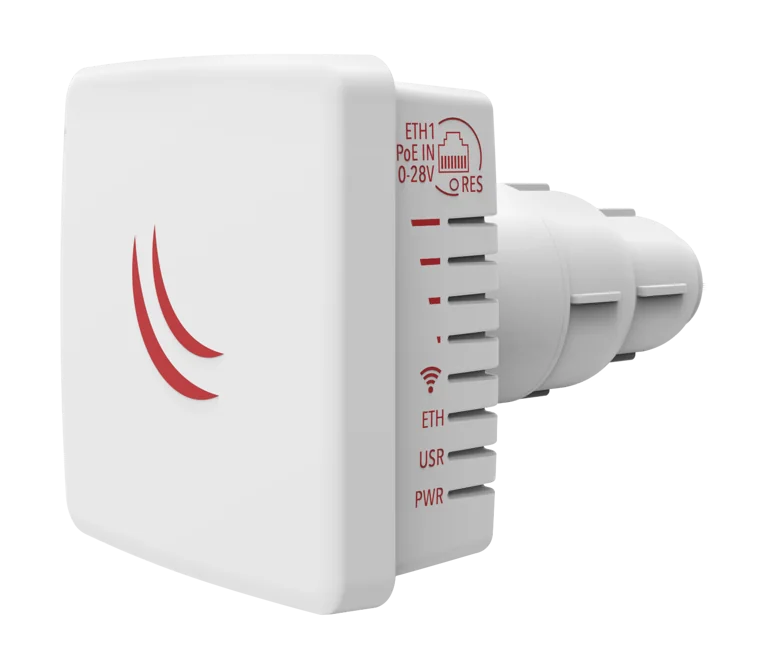
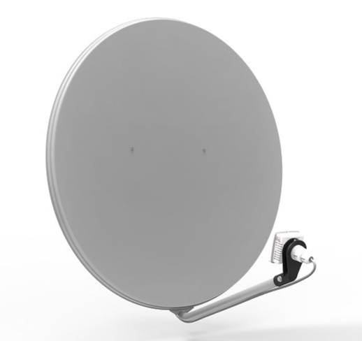
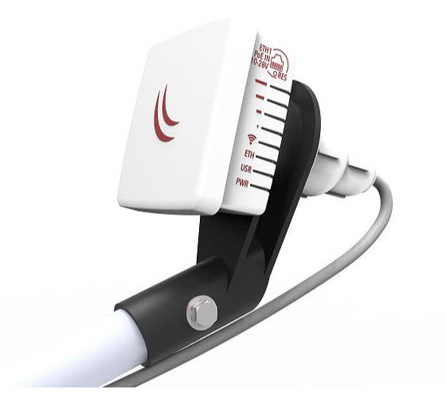

## [LDF 5 ac](https://mikrotik.com/product/ldf_5_ac) (RBLDFG-5acD)

The LDF (Lite dish feed) is an outdoor wireless system with a built-in antenna, meant to be installed on satellite offset dish antennas.

## Safety Warnings

- Before you work on any equipment, be aware of the hazards involved with electrical circuitry, and be familiar with standard practices for preventing accidents.
- Ultimate disposal of this product should be handled according to all national laws and regulations.
- The Installation of the equipment must comply with local and national electrical codes.
- This product is intended to be mounted outdoors on a pole. Please read the mounting instructions carefully before beginning installation. Failure to use the correct hardware and configuration or to follow the correct procedures could result in a hazardous situation for people and damage to the system.
- Use only the power supply and accessories approved by the manufacturer, and which can be found in the original packaging of this product.
- Read the installation instructions before connecting the system to the power source.
- We cannot guarantee that no accidents or damage will occur due to the improper use of the device. Please use this product with care and operate at your own risk!
- In the case of device failure, please disconnect it from power. The fastest way to do so is by unplugging the power plug from the power outlet.
- It is the customer's responsibility to follow local country regulations, including operation within legal frequency channels, output power, cabling requirements, and Dynamic Frequency Selection (DFS) requirements. All MikroTik radio devices must be professionally installed.
- This is a class A device. In a domestic environment, this product might cause radio interference in which case the user might be required to take adequate measures.

**Exposure to Radio Frequency Radiation:** This MikroTik equipment complies with the FCC, IC, and European Union radiation exposure limits set forth for an uncontrolled environment. This MikroTik device should be installed and operated no closer than 20 centimeters from your body, occupational user, or the general public.

## Assembly

The device is compatible with standard offset dishes, commonly used for satellite television. The offset mount is universal at 40 mm diameter, and the LDF can easily be placed inside it. To attach the Ethernet cable to the LDF unit, follow these steps:

- Assemble all components as shown in the illustration. If using pre-made cables, cut the rubber seal on one side, to put it onto the cable. Self crimped cables should be crimped after the seal is on the cable;
- Connect Ethernet cable to Ethernet connector on LDF;
- Attach Housing nut to LDF body by rotating clockwise;
- Slide rubber seal into housing nut, then seal the waterproof gland by turning compression nut clockwise.

## Assembling on dish

Please ensure to mount the LDF unit on the offset mount in the proper position as shown in the picture to the right. Unit facing upwards to the dish.

The dish will act as a reflector, amplifying the signal. The final position of your assembly should be placed and installed on the pole or wall as shown on the picture to the left.

## Mounting

The IP rating scale for this device is IP54. The Device designed to use outdoors, please ensure that any cable openings are directed downwards. Use POE injector with Cat6 cable. Installation infrastructure (towers and masts), as well as the router itself, to be properly grounded.

*Mounting and configuration of this device should be done by a qualified person.* *Warning! This equipment should be installed and operated with a minimum distance of 28 cm between the device and your body. Operation of this equipment in the residential environment could cause radio interference.*

## Powering

The device accepts 10-28 V ⎓ DC input from passive Power over Ethernet injectors. The device does not work with IEEE802.3af compliant 48 V power injectors. A PoE injector is included in the package. Maximum power consumption:

- LDF 5, 6 W;
- LDF 5 ac, 8 W.

### Connecting to a PoE Adapter

- Connect the Ethernet cable from the device to the PoE+DATA port of the PoE adapter;
- Connect an Ethernet cable from your local network (LAN) to the PoE adapter;
- Connect the power cord to the adapter, and then plug the power cord into a power outlet.

## Quickstart

Please follow these quick steps to set up your device:

- Connect the device to the included PoE injector with an Ethernet cable to the data+power end;
- Connect the data end of the PoE injector to the computer;
- Connect the power adapter to the PoE injector;
- Configure your device using a web browser through **WebFig** or the **WinBox** tool at [https://mt.lv/WinBox](https://mt.lv/WinBox); multiple configuration methods are available to ensure accessibility;
- Access **WebFig** by opening [https://192.168.88.1](https://192.168.88.1), and for **WinBox**, download the tool, navigate to the **Neighbors** tab, and click on the MAC address. The username is "**admin**" with no password (or, for some models, check user and wireless passwords on the sticker);
- For a manual update of the device, visit mikrotik.com, select your model, and locate the required packages in the "Downloads" section;
- Upload downloaded packages to the **WebFig** or **WinBox** "**Files**" menu and reboot the device;
- Updating your RouterOS software to the latest version will ensure the best performance, stability, and security updates;
- In the "Quick Set" menu set up the following: Choose your country, to apply country regulation settings;
- Set up your wireless network password in the left field;
- Set up your router password in the bottom field.

## Configuration

Once logged in, we recommend clicking the "Check for updates" button in the QuickSet menu, as updating your RouterOS software to the latest version ensures the best performance and stability. For wireless models, please make sure you have selected the country where the device will be used, to conform with local regulations. RouterOS includes many configuration options in addition to what is described in this document. We suggest starting here to get yourself accustomed to the possibilities: [https://mt.lv/help](https://mt.lv/help) In case IP connection is not available, the WinBox tool ([https://mt.lv/winbox](https://mt.lv/winbox)) can be used to connect to the MAC address of the device from the LAN side (all access is blocked from the Internet port by default). For recovery purposes, it is possible to boot the device for reinstallation, see section .

## Extension slots and ports

-

Integrated wireless: LDF 5, 5 GHz, 802.11a/n; LDF 5 ac, 5 GHz, 802.11a/n/ac.

-

One Ethernet port, supporting automatic cross/straight cable correction (Auto MDI/X), so you can use either straight or cross-over cables for connecting to other network devices.

## Buttons and jumpers

The reset button has three functions:

- Hold this button during boot time until LED light starts flashing, release the button to reset RouterOS configuration (total 5 seconds);
- Keep holding for 5 more seconds, LED turns solid, release now to turn on CAP mode. The device will now look for a CAPsMAN server (total 10 seconds);
- Or Keep holding the button for 5 more seconds until LED turns off, then release it to make the RouterBOARD look for Netinstall servers (total 15 seconds); Regardless of the above option used, the system will load the backup RouterBOOT loader if the button is pressed before power is applied to the device. Useful for RouterBOOT debugging and recovery.

## Specifications

For more information about this product, specifications, pictures, downloads and test results please visit our web page:

- LDF 5 - [https://mikrotik.com/product/rbldf_5nd](https://mikrotik.com/product/rbldf_5nd)
- LDF 5 ac - [https://mikrotik.com/product/ldf_5_ac](https://mikrotik.com/product/ldf_5_ac)

## MikroTik mobile app

Use the MikroTik smartphone app to configure your router in the field, or to apply the most basic initial settings for your MikroTik home access point:

- Scan the QR code and choose your preferred OS.
- Install and open the application.
- Click Connect to establish a connection to your device through a wireless network (check the wireless passwords on the sticker).
- The username is "**admin**" and there is no password (or, for some models, check user and wireless passwords on the sticker).
- Choose Quick Setup and the application will guide you through all basic configuration settings in a couple of easy steps.
- An advanced menu is available to fully configure all necessary settings.

## Operating system support

The device supports RouterOS v7 and above. The specific factory-installed version is listed in /system resource. Other operating systems have not been tested.

To avoid pollution of the environment, please separate the device from household waste and dispose of it in a safe manner, such as in designated waste disposal sites. Familiarize yourself with the procedures for the proper transportation of the equipment to the designated disposal sites in your area.

## Federal Communication Commission Interference Statement

<table><thead><tr><th>Model</th><th>FCC ID</th></tr></thead><tbody><tr><td>LDF 5</td><td>TV7LHG5NDM</td></tr><tr><td>LDF 5 ac</td><td>TV7LHG5ACD</td></tr></tbody></table>

This equipment has been tested a

nd found to comply with the limits for a Class A digital device, pursuant to Part 15 of the FCC Rules. These limits are designed to provide reasonable protection against harmful interference in a commercial installation.

This equipment generates, uses, and can radiate radio frequency energy and, if not installed and used in accordance with the instruction manual, may cause harmful interference to radio communications. Operation of this equipment in a residential area is likely to cause harmful interference in which case the user will be required to correct the interference at his own expense.

FCC Caution: Any changes or modifications not expressly approved by the party responsible for compliance could void the user's authority to operate this equipment. This device complies with Part 15 of the FCC Rules. Operation is subject to the following two conditions: (1) This device may not cause harmful interference, and (2) this device must accept any interference received, including interference that may cause undesired operation. This device and its antenna must not be co-located or operation in conjunction with any other antenna or transmitter. **IMPORTANT: Exposure to Radio Frequency Radiation.** 20 cm minimum distance has to be maintained between the antenna and the occupational user and 28 cm to the general public. Under such configuration, the FCC radiation exposure limits set forth for a population/uncontrolled environment can be satisfied. **Antenna Installation. WARNING:** It is the installer's responsibility to ensure that when using the authorized antennas in the United States (or where FCC rules apply); only those antennas certified with the product are used. The use of any antenna other than those certified with the product is expressly forbidden in accordance with FCC rules CFR47 part 15.204. The installer should configure the output power level of antennas, according to country regulations and per antenna type. Professional installation is required for equipment with connectors to ensure compliance with health and safety issues. Approved antennas:

- MikroTik Dual Polarity, Directional (9.0 dBi and 16.0);
- Short Backfire, Directional (21 dBi);
- Parabolic Dish (24.5 dBi and 27.0 dBi).

## OEM statement

This module is intended for OEM installations only. As such the OEM integrator is responsible for ensuring that the end-user has no manual instructions to remove install or modify the module. This module is limited to installations in mobile or fixed applications. OEM integrators may utilize antennas of like an equal or lesser gain as appearing in the list in this document (reference 47 CFR, paragraph 15.204(c)(4) for further information on this topic. The MikroTik OEM RF Module complies with Part 15 of the FCC rules and regulations. OEM Modules have been certified by the FCC for use with other products without any further certification (as per FCC section 2.1091). Separate approval is required for other operating configurations including portable configurations concerning to 47CFR paragraphs 2.1093 and different antenna configurations. The OEM is required to comply with all 47CFR labeling instructions and requirements for the finished products. Changes or modifications not expressly approved by MikroTik could void the OEM authority to install or operate the equipment. OEMs must test their final product to comply with unintentional radiators (FCC section 15.107 and 15.109) before declaring compliance with their final product to Part 15 of the FCC Rules. **WARNING**: the OEM must ensure that the FCC labeling requirements are met. This includes a visible labels on the outside of the OEM enclosure specifying the appropriate MikroTik OEM RF Module FCC identifier for this product as well as any other required FCC notices as presented above. This enclosed device complies with 47CFR paragraph 15 C of the FCC rules and regulations. Operation is subject to the following two conditions: (1) this device may not cause harmful interference, and (2) this device must accept any interference received, including interference that may cause undesired operation. Labeling and text information should be of a size of type large enough to be readily legible, consistent with the dimensions of the equipment and the label.

## Innovation, Science and Economic Development Canada

<table><thead><tr><th>Model</th><th>IC</th></tr></thead><tbody><tr><td>LDF 5</td><td>7442A-LHG5NDM</td></tr><tr><td>LDF 5 ac</td><td>7442A-LHG5ACD</td></tr></tbody></table>

This device complies with Industry Canada's licence-exempt RSS standard(s). Operation is subject to the following two conditions: (1) this device may not cause interference, and (2) this device must accept any interference, including interference that may cause undesired operation of the device. Le présent appareil est conforme aux CNR d'Industrie Canada applicables aux appareils radio exempts de licence. L'exploitation est autorisée aux deux conditions suivantes : (1) l'appareil ne doit pas produire de brouillage, et (2) l'utilisateur de l'appareil doit accepter tout brouillage radioélectrique subi, même si le brouillage est susceptible d'en compromettre le fonctionnement.

This Class A digital apparatus complies with Canadian ICES-003.

Cet appareil numérique de la classe [A] est conforme à la norme NMB-003 du Canada.

CAN ICES-003 (A) / NMB-003 (A)

The device for operation in the band 5150–5250 MHz is only for indoor use to reduce the potential for harmful interference to co-channel mobile satellite systems. Users should also be advised that high-power radars are allocated as primary users (i.e. priority users) of the bands 5250-5350 MHz and 5650-5850 MHz and that these radars could cause interference and/or damage to LE-LAN devices. Les dispositifs fonctionnant dans la bande de 5 150 a 5 250 MHz sont reserves uniquement pour une utilisation a l'interieur afin de reduire les risques de brouillage prejudiciable aux systemes de satellites mobiles utilisant les memes canaux. Les utilisateurs devraient aussi etre avises, d'une part, que les utilisateurs de radars de haute puissance sont designes utilisateurs principaux (c.-a-d., qu'ils ont la priorite) des bandes de 5 250 a 5 350 MHz et de 5 650 a 5 850 MHz et, d'autre part, que ces radars pourraient causer du brouillage et/ou des dommages aux dispositifs de RL-EL.

## UKCA Marking

## Eurasian Conformity Mark

<table><thead><tr><th>Частотный каналы</th><th>Мощность передатчика</th></tr></thead><tbody><tr><td>5150-5350 МГц, 5650-5850 МГц</td><td>≤10 Вт</td></tr></tbody></table>

*Доступные частотные каналы могут различаться в зависимости от модели продукта и сертификации.

Информация о дате изготовления устройства указана в конце серийного номера на его наклейке через дробь. Первая цифра означает номер года (последняя цифра года), две последующие означают номер недели.

Изготовитель: MikroTikls SIA, Aizkraukles iela 23, Riga, LV-1006, Латвия, [support@mikrotik.com](mailto:support@mikrotik.com). Сделано в Китае, Латвии или Литве. Cм. на упаковке.

Для получения подробных сведений о гарантийном обслуживании обратитесь к продавцу. Информация об импортерах продукции MikroTik в Российскую Федерацию: [https://mikrotik.com/buy/europe/russia](https://mikrotik.com/buy/europe/russia)

Продукты MikroTik, которые поставляются в Евразийский таможенный союз, оцениваются с учетом соответствующих требований и помечены знаком EAC, как показано ниже:

## Norma Oficial Mexicana

Rango de frecuencia (potencia de salida máxima): 5725-5850 MHz (30 dBm). Los canales de frecuencia disponibles pueden variar según el modelo y la certificación del producto.

EFICIENCIA ENERGETICA CUMPLE CON LA NOM-029-ENER-2017.

La operacion de este equipo esta sujeta a las siguientes dos condiciones:

Es posible que este equipo o dispositivo no cause interferencia perjudicial y. Este equipo debe aceptar cualquier interferencia, incluyendo la que pueda causar su operacion no deseada.

Fabricante: MikroTikls SIA, Brivibas gatve 214i, Riga, LV-1039, Latvia.

País De Origen: Letonia; Lituania; China (Republica Popular); Estados Unidos De America; Mexico.

Por favor contacte a su distribuidor local para preguntas regionales específicas. La lista de importadores se puede encontrar en nuestra página de inicio – [https://mikrotik.com/buy/latinamerica/mexico](https://mikrotik.com/buy/latinamerica/mexico).

## The National Commission for the State Regulation of Communications and Informatization by Ukraine

Виробник: MikroTikls SIA, Brivibas gatve 214i Рига, Латвія, LV1039.

Робоча частота (Максимальна вихідна потужність): 5150-5250 МГц (23 дБм), 5250-5350 МГц (20 дБм), 5470-5725 МГц (27 дБм).

Справжнім MikroTikls SIA заявляє, що маршрутизатор відповідає основним вимогам та іншим відповідним положенням директиви 2014/53/EC, а також суттєвим вимогам Технічного регламенту радіообладнання, затвердженого постановою Кабінету Міністрів України від 24 травня 2017 року № 355.

Для експлуатації в Україні необхідно отримати дозвіл на експлуатацію у порядку, затвердженому рішенням НКРЗІ від 01.11.2012 № 559, зареєстрованому в Міністерстві юстиції України 03.01.2013 за № 57/22589.

### CE Declaration of Conformity

Manufacturer: MikroTikls SIA, Brivibas gatve 214i Riga, Latvia, LV1039.

Hereby, Mikrotīkls SIA declares that the radio equipment type RouterBOARD is in compliance with Directive 2014/53/EU. The full text of the EU declaration of conformity is available at the following internet address: [https://mikrotik.com/products](https://mikrotik.com/products)

### Frequency bands terms of use

<table><thead><tr><th>Frequency range (for applicable models)</th><th>Channels used</th><th>Maximum Output Power (EIRP)</th><th>Restriction</th></tr></thead><tbody><tr><td>5150-5250 MHz</td><td>26 - 48</td><td>23 dBm</td><td>Restricted to indoor use only*</td></tr><tr><td>5250-5350 MHz</td><td>52 - 64</td><td>20 dBm</td><td>Restricted to indoor use only*</td></tr><tr><td>5470-5725 MHz</td><td>100 - 140</td><td>27 dBm</td><td>Without any restriction to use in all EU Member States</td></tr></tbody></table>

**It is the customer's responsibility to follow local country regulations, including operation within legal frequency channels, output power, cabling requirements, and Dynamic Frequency Selection (DFS) requirements. All MikroTik radio devices must be professionally installed!**

This MikroTik device meets Maximum WLAN transmit power limits per ETSI regulations. For more detailed information see Declaration of Conformity above / Dieses MikroTik-Gerät erfüllt die maximalen WLAN- Sendeleistung Grenzwerte gemäß ETSI-Bestimmungen. Weitere Informationen finden Sie oben unter Konformitätserklärung / Cet appareil MikroTik respecte les limites maximales de puissance de transmission WLAN conformément aux réglementations ETSI. Pour plus d'informations, voir la déclaration de conformité ci-dessus / Questo dispositivo MikroTik è conforme ai limiti massimi di potenza di trasmissione WLAN in conformità con le normative ETSI. Per ulteriori informazioni, consultare la dichiarazione di conformità sopra / Este dispositivo MikroTik cumple con los límites máximos de potencia de transmisión WLAN de acuerdo con las regulaciones ETSI. Para obtener más información, consulte la declaración de conformidad anterior / Это устройство MikroTik соответствует максимальным пределам мощности передачи WLAN в соответствии с правилами ETSI. Для получения дополнительной информации см. Декларацию соответствия выше.
