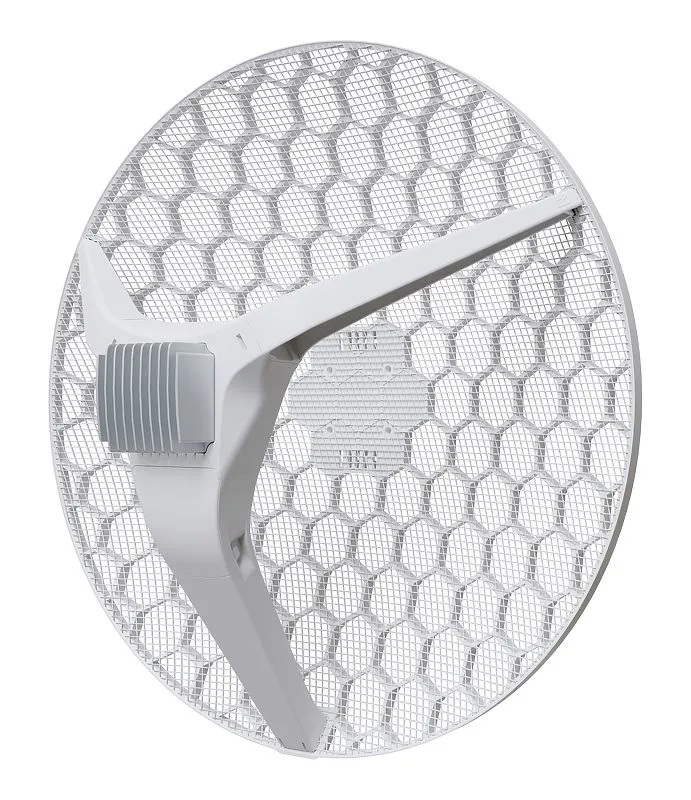
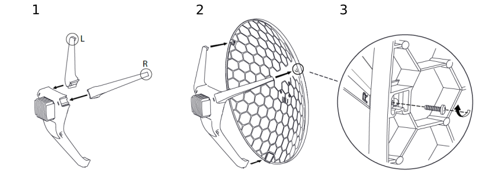
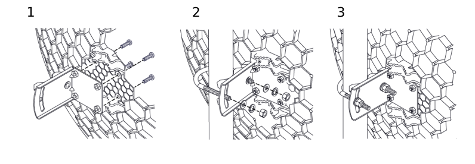
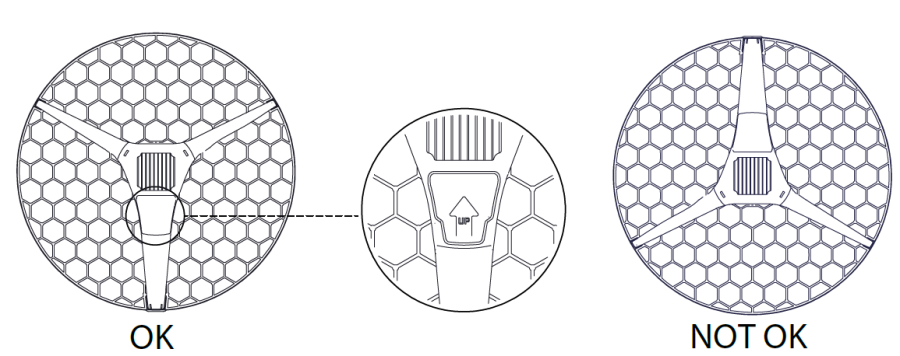
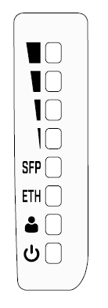

## [LHG XL 52 ac](https://mikrotik.com/product/lhg_xl_52_ac) (RBLHGG-5HPacD2HPnD-XL)

Extremely powerful dual-band backbone / CPE for long-distance connection without downtime. See the [LHG XL 52 ac product page](https://mikrotik.com/product/lhg_xl_52_ac) for full specifications and brochures.

## Safety Warnings

- Before you work on any equipment, be aware of the hazards involved with electrical circuitry, and be familiar with standard practices for preventing accidents.
- Ultimate disposal of this product should be handled according to all national laws and regulations.
- All installation methods for mounting an access point on any wall surface is subject to the acceptance of local jurisdiction.
- The Installation of the equipment must comply with local and national electrical codes.
- This product is intended to be mounted outdoors on a pole. Please read the mounting instructions carefully before beginning installation. Failure to use the correct hardware and configuration or to follow the correct procedures could result in a hazardous situation for people and damage to the system.
- Use only the power supply and accessories approved by the manufacturer, and which can be found in the original packaging of this product.
- Read the installation instructions before connecting the system to the power source.
- We cannot guarantee that no accidents or damage will occur due to the improper use of the device. Please use this product with care and operate at your own risk!
- In the case of device failure, please disconnect it from power. The fastest way to do so is by unplugging the power plug from the power outlet.
- It is the customer's responsibility to follow local country regulations, including operation within legal frequency channels, output power, cabling requirements, and Dynamic Frequency Selection (DFS) requirements. All MikroTik radio devices must be professionally installed.

**Exposure to Radio Frequency Radiation:** This MikroTik equipment complies with the FCC, IC, and European Union radiation exposure limits set forth for an uncontrolled environment. This MikroTik device should be installed and operated no closer than 20 centimeters from your body, occupational user, or the general public.

## Quickstart

Please follow these quick steps to set up your device:

- Assemble unit (see Assembling).
- Open the Ethernet door.
- Connect the device to the PoE (see Connecting to a PoE Adapter).
- Mount unit (see Mounting).
- Open network connections on your PC, mobile phone or other device and search for MikroTik wireless network and connect to it.
- The configuration can be done through the wireless network using a web browser or mobile app - (see Configuration). Alternatively, you can use the **WinBox** configuration tool [https://mt.lv/winbox](https://mt.lv/winbox).
- Once connected to the wireless network, open [https://192.168.88.1](https://192.168.88.1) in your web browser to start configuration, user name: **admin** and there is no password by default (or, for some models, check user and wireless passwords on the sticker).
- When using a mobile application choose Quick setup and it will guide you through all necessary configuration in six easy steps.
- We recommend clicking the "Check for updates" button and updating your RouterOS software to the latest version to ensure the best performance and stability.
- Choose your country, to apply country regulation settings and set up your password on the screen that loads.

## Powering

The device accepts the power to the Ethernet port:

- PoE 802.3af/at 12-57 V DC ⎓. The power consumption under maximum load can reach 18 W. Without attachments 16 W.

### Connecting to a PoE Adapter

- Connect the Ethernet cable from the device to the PoE+DATA port of the PoE adapter.
- Connect an Ethernet cable from your local network (LAN) to the PoE adapter.
- Connect the power cord to the adapter, and then plug the power cord into a power outlet.

## MikroTik mobile app

Use the MikroTik smartphone app to configure your router in the field, or to apply the most basic initial settings for your MikroTik home access point.

- Scan QR code and choose your preferred OS.
- Install and open application.
- By default, the IP address and user name will be already entered.
- Click Connect to establish a connection to your device through a wireless network.
- Choose Quick setup and application will guide you through all basic configuration settings in a couple of easy steps.
- An advanced menu is available to fully configure all necessary settings.

## Assembling

The device needs to be assembled from four parts, LHG dish, two legs and, the main body.

- Attach two legs to the main body, legs are different and marked with L and R.
- Attach the assembly to the dish.
- Secure with provided screws using PH2 screwdriver.

## Mounting

The LHG XL ac is designed to be used outdoors and mounted on pole or mast. The package includes an adjustable mounting assembly.

When mounting, please ensure that cable feed is pointing downwards. The IP rating scale of this device is IP54. We recommend using Cat6 shielded cables. Warning! This equipment should be installed and operated with a minimum distance of 20 cm between the device and your body. Operation of this equipment in the residential environment could cause radio interference. Mounting and configuration of this device should be done by a qualified person.

The Mounting assembly is provided with the package.

- Attach the mounting assembly to the back of the dish using four screws.
- Attach the unit to the pole using U clamp placing washers and nuts in order as shown on the illustration.
- Align the unit accordingly to the signal and secure nuts.
- The device should be always placed by UP arrow facing upwards.

## Grounding

The installation infrastructure (towers and masts), as well as the router itself, must be properly grounded. The device includes a grounding wire attachment connector behind the Ethernet door. Attach your grounding wire to the grounding connector, then attach the other end of the grounding wire to the grounded mast. Please secure all loose Ethernet cables and antenna cables to the pole or mast approximately 30cm from the device, so that the cable weight is not pulling the ports and connectors.

## Front status LED behavior

RouterOS allows configuring each LED's activity the way that the user wishes. It is possible to configure the LEDs to display wireless strength, blink the LEDs on interface traffic activity and many other options. For further information please visit the [LEDs](/docs/7.24/hardware/leds) manual page. Default factory configuration for this device:

- Green LED the fourth level of signal strength.
- Green LED the third level of signal strength.
- Green LED the second level of signal strength.
- Green LED the first level of signal strength.
- Solid Green – Active SFP port.
- Solid Green – Active Ethernet port.
- Solid Green – User-defined LED.
- Solid Blue – The device is powered on.

## Operating system support

The device supports RouterOS v7 and above. The specific factory-installed version is listed in /system resource. Other operating systems have not been tested.

## Configuration

The device is configured as a wireless client, you will need to select AP to connect and set up a password. We recommend clicking the "Check for updates" button in the QuickSet menu, as updating your RouterOS software to the latest version ensures the best performance and stability. Please make sure you have selected the country where the device will be used, to conform with local regulations. RouterOS includes many configuration options in addition to what is described in this document. We suggest starting here to get yourself accustomed to the possibilities: [https://mt.lv/help](https://mt.lv/help) In case IP connection is not available, the WinBox tool ([https://mt.lv/winbox](https://mt.lv/winbox)) can be used to connect to the MAC address of the device from the LAN side (all access is blocked from the Internet port by default). For recovery purposes, it is possible to boot the device for reinstallation, see a section Reset button.

## Extension slots and ports

- Gigabit Ethernet port, supporting automatic cross/straight cable correction (Auto MDI/X). Either straight or crossover cable can be used for connecting to other network devices.
- SFP port.
- Integrated Wireless module operating at 2.4 GHz, 802.11b/g/n protocol.
- Integrated Wireless module operating at 5 GHz, 802.11a/n/ac protocol.

## Reset button

The reset button has three functions:

- Hold this button during boot time until LED light starts flashing, release the button to reset RouterOS configuration (total 5 seconds).
- Keep holding for 5 more seconds, LED turns solid, release now to turn on CAP mode. The device will now look for a CAPsMAN server (total 10 seconds).
- Or Keep holding the button for 5 more seconds until LED turns off, then release it to make the RBLHGG-5HPacD2HPnD-XL look for Netinstall servers (total 15 seconds). Regardless of the above option used, the system will load the backup RouterBOOT loader if the button is pressed before power is applied to the device. Useful for RouterBOOT debugging and recovery.

## Accessories

Package includes the following accessories that come with the device:

- EU Switching Power Supply 24 V ⎓ 1.2 A 28.8 W 86.8 % VI 220 cm RA DC plug mod Hor shorter plug.
- Gigabit POE injector.
- LHG case
- LHG legs L, R.
- LHG XL 550mm Dish
- Montage assembly
- LHG 2 fastening set.
- LHG 60 fastening set. Please see the [MikroTik SFP module compatibility table](/docs/7.24/wired-connections/mikrotik-wired-interface-compatibility).

## Specifications

For more information about this product, specifications, pictures, downloads and test results please visit our web page: [https://mikrotik.com/product/lhg_xl_52_ac](https://mikrotik.com/product/lhg_xl_52_ac)

To avoid pollution of the environment, please separate the device from household waste and dispose of it in a safe manner, such as in designated waste disposal sites. Familiarize yourself with the procedures for the proper transportation of the equipment to the designated disposal sites in your area.

## Federal Communication Commission Interference Statement

<table><thead><tr><th>Model</th><th>FCC ID</th></tr></thead><tbody><tr><td>RBLHGG-5HPacD2HPnD-XL</td><td>TV7LHG5HPACD2HPD</td></tr></tbody></table>

This equipment has been tested and found to comply with the limits for a Class B digital device, pursuant to Part 15 of the FCC Rules. These limits are designed to provide reasonable protection against harmful interference in a residential installation.

This equipment generates, uses and can radiate radio frequency energy and, if not installed and used in accordance with the instructions, may cause harmful interference to radio communications. However, there is no guarantee that interference will not occur in a particular installation. If this equipment does cause harmful interference to radio or television reception, which can be determined by turning the equipment off and on, the user is encouraged to try to correct the interference by one of the following measures:

- Reorient or relocate the receiving antenna.
- Increase the separation between the equipment and receiver.
- Connect the equipment into an outlet on a circuit different from that to which the receiver is connected.
- Consult the dealer or an experienced radio/TV technician for help. FCC Caution: Any changes or modifications not expressly approved by the party responsible for compliance could void the user's authority to operate this equipment. This device complies with Part 15 of the FCC Rules. Operation is subject to the following two conditions: (1) This device may not cause harmful interference, and (2) this device must accept any interference received, including interference that may cause undesired operation. This device and its antenna must not be co-located or operation in conjunction with any other antenna or transmitter. For use of CBRS bands, the CBSD Category of the final Host equipment will be dependent on the power settings and antenna gain used. **IMPORTANT: Exposure to Radio Frequency Radiation.** This equipment complies with the FCC RF radiation exposure limits set forth for an uncontrolled environment. This equipment should be installed and operated with a minimum distance of 20 cm between the radiator and any part of your body.

## Innovation, Science and Economic Development Canada

<table><thead><tr><th>Model</th><th>IC</th></tr></thead><tbody><tr><td>RBLHGG-5HPacD2HPnD-XL</td><td>7442A-LHG5ACD2HPD</td></tr></tbody></table>

This device complies with Industry Canada licence-exempt RSS standard(s). Operation is subject to the following two conditions: (1) this device may not cause interference, and (2) this device must accept any interference, including interference that may cause undesired operation of the device. Le présent appareil est conforme aux CNR d'Industrie Canada applicables aux appareils radio exempts de licence. L'exploitation est autorisée aux deux conditions suivantes : (1) l'appareil ne doit pas produire de brouillage, et (2) l'utilisateur de l'appareil doit accepter tout brouillage radioélectrique subi, même si le brouillage est susceptible d'en compromettre le fonctionnement.

The device for operation in the band 5150–5250 MHz is only for indoor use to reduce the potential for harmful interference to co-channel mobile satellite systems.

Les dispositifs fonctionnant dans la bande de 5 150 à 5 250 MHz sont réservés uniquement pour une utilisation à l'intérieur afin de réduire les risques de brouillage préjudiciable aux systèmes de satellites mobiles utilisant les mêmes canaux.

This Class B digital apparatus complies with Canadian ICES-003.

Cet appareil numérique de la classe [B] est conforme à la norme NMB-003 du Canada.

CAN ICES-003 (B) / NMB-003 (B)

**IMPORTANT: Exposure to Radio Frequency Radiation.** This equipment complies with the IC radiation exposure limits set forth for an uncontrolled environment. This equipment should be installed and operated with a minimum distance of 20 cm between the radiator and any part of your body. Cet équipement est conforme aux limites d'exposition au rayonnement IC définies pour un environnement non contrôlé. Cet équipement doit être installé et utilisé à une distance minimale de 20 cm entre le radiateur et toute partie de votre corps.

## UKCA marking

## Eurasian Conformity Mark

<table><thead><tr><th>Частотный каналы</th><th>Мощность передатчика</th></tr></thead><tbody><tr><td>2400-2483.5 МГц, 5150-5350 МГц, 5650-5850 МГц</td><td>≤10 Вт</td></tr></tbody></table>

*Доступные частотные каналы могут различаться в зависимости от модели продукта и сертификации.

Информация о дате изготовления устройства указана в конце серийного номера на его наклейке через дробь. Первая цифра означает номер года (последняя цифра года), две последующие означают номер недели.

Изготовитель: MikroTikls SIA, Aizkraukles iela 23, Riga, LV-1006, Латвия, [support@mikrotik.com](mailto:support@mikrotik.com). Сделано в Китае, Латвии или Литве. Cм. на упаковке.

Для получения подробных сведений о гарантийном обслуживании обратитесь к продавцу. Информация об импортерах продукции MikroTik в Российскую Федерацию: [https://mikrotik.com/buy/europe/russia](https://mikrotik.com/buy/europe/russia)

Продукты MikroTik, которые поставляются в Евразийский таможенный союз, оцениваются с учетом соответствующих требований и помечены знаком EAC, как показано ниже:

## Norma Oficial Mexicana

Rango de frecuencia (potencia de salida máxima): 2400-2483.5 MHz (30 dBm), 5725-5850 MHz (30 dBm). Los canales de frecuencia disponibles pueden variar según el modelo y la certificación del producto.

EFICIENCIA ENERGETICA CUMPLE CON LA NOM-029-ENER-2017.

La operacion de este equipo esta sujeta a las siguientes dos condiciones:

- Es posible que este equipo o dispositivo no cause interferencia perjudicial y.
- Este equipo debe aceptar cualquier interferencia, incluyendo la que pueda causar su operacion no deseada. Fabricante: MikroTikls SIA, Brivibas gatve 214i, Riga, LV-1039, Latvia.

País De Origen: Letonia; Lituania; China (Republica Popular); Estados Unidos De America; Mexico.

Por favor contacte a su distribuidor local para preguntas regionales específicas. La lista de importadores se puede encontrar en nuestra página de inicio – [https://mikrotik.com/buy/latinamerica/mexico](https://mikrotik.com/buy/latinamerica/mexico).

## The National Commission for the State Regulation of Communications and Informatization by Ukraine

Виробник: MikroTikls SIA, Brivibas gatve 214i Рига, Латвія, LV1039.

Робоча частота (Максимальна вихідна потужність): 2400-2483.5 МГц (30 дБм), 5150-5250 МГц (23 дБм), 5250-5350 МГц (20 дБм), 5470-5725 МГц (27 дБм).

Справжнім MikroTikls SIA заявляє, що маршрутизатор відповідає основним вимогам та іншим відповідним положенням директиви 2014/53/EC, а також суттєвим вимогам Технічного регламенту радіообладнання, затвердженого постановою Кабінету Міністрів України від 24 травня 2017 року № 355.

Для експлуатації в Україні необхідно отримати дозвіл на експлуатацію у порядку, затвердженому рішенням НКРЗІ від 01.11.2012 № 559, зареєстрованому в Міністерстві юстиції України 03.01.2013 за № 57/22589.

## CE Declaration of Conformity

Manufacturer: MikroTikls SIA, Brivibas gatve 214i Riga, Latvia, LV1039.

Hereby, Mikrotīkls SIA declares that the radio equipment type RBLHGG-5HPacD2HPnD-XL is in compliance with Directive 2014/53/EU. The full text of the EU declaration of conformity is available at the following internet address:[https://mikrotik.com/products](https://mikrotik.com/products)

### Frequency bands terms of use

<table><thead><tr><th>Frequency range (for applicable models)</th><th>Channels used</th><th>Maximum Output Power (EIRP)</th><th>Restriction</th></tr></thead><tbody><tr><td>2412-2472 MHz</td><td>1 - 13</td><td>20 dBm</td><td>Without any restriction to use in all EU Member States</td></tr><tr><td>5150-5250 MHz</td><td>26 - 48</td><td>23 dBm</td><td>Restricted to indoor use only*</td></tr><tr><td>5250-5350 MHz</td><td>52 - 64</td><td>20 dBm</td><td>Restricted to indoor use only*</td></tr><tr><td>5470-5725 MHz</td><td>100 - 140</td><td>27 dBm</td><td>Without any restriction to use in all EU Member States</td></tr></tbody></table>

**It is the customer's responsibility to follow local country regulations, including operation within legal frequency channels, output power, cabling requirements, and Dynamic Frequency Selection (DFS) requirements. All MikroTik radio devices must be professionally installed!**

This MikroTik device meets Maximum WLAN transmit power limits per ETSI regulations. For more detailed information see Declaration of Conformity above / Dieses MikroTik-Gerät erfüllt die maximalen WLAN- Sendeleistung Grenzwerte gemäß ETSI-Bestimmungen. Weitere Informationen finden Sie oben unter Konformitätserklärung / Cet appareil MikroTik respecte les limites maximales de puissance de transmission WLAN conformément aux réglementations ETSI. Pour plus d'informations, voir la déclaration de conformité ci-dessus / Questo dispositivo MikroTik è conforme ai limiti massimi di potenza di trasmissione WLAN in conformità con le normative ETSI. Per ulteriori informazioni, consultare la dichiarazione di conformità sopra / Este dispositivo MikroTik cumple con los límites máximos de potencia de transmisión WLAN de acuerdo con las regulaciones ETSI. Para obtener más información, consulte la declaración de conformidad anterior / Это устройство MikroTik соответствует максимальным пределам мощности передачи WLAN в соответствии с правилами ETSI. Для получения дополнительной информации см. Декларацию соответствия выше.

***BG. Инструк***
