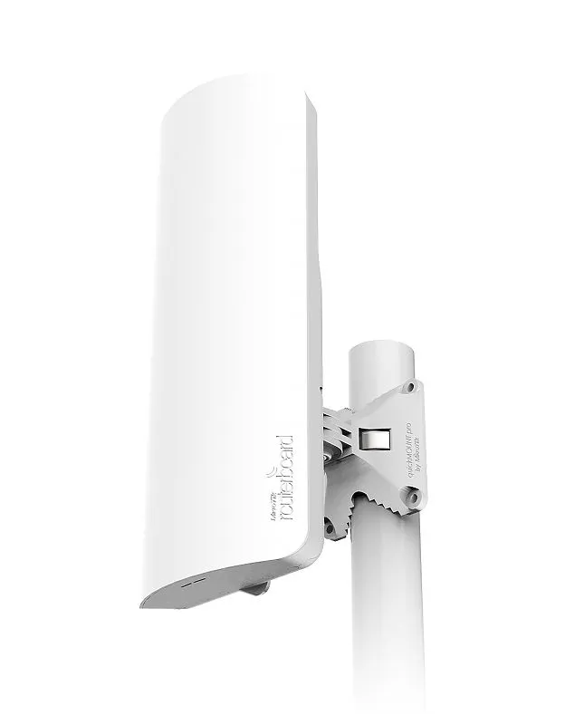
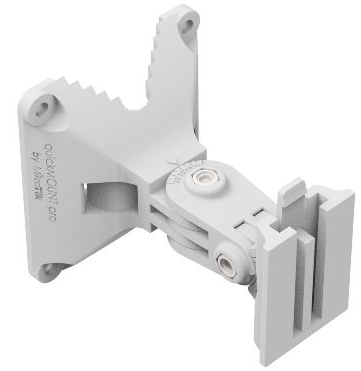
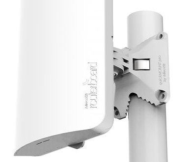
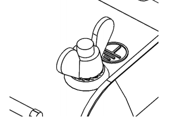
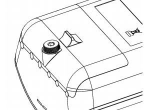

## [mANTBox 52 15s](https://mikrotik.com/product/mantbox_52_15s) (RBD22UGS-5HPacD2HnD-15S)

mANTBox 52 15s. See the [MANTBox 52 15s product page](https://mikrotik.com/product/mantbox_52_15s) for full specifications and brochures.

## Safety Warnings

- Before you work on any equipment, be aware of the hazards involved with electrical circuitry, and be familiar with standard practices for preventing accidents.
- Read the installation instructions before connecting the system to the power source.
- This equipment is to be installed by trained and qualified personnel, as per these installation instructions. The installer is responsible for obtaining any required local or national safety inspections of the structural integrity of the installation by the local authority/inspection department.
- All installation methods for mounting an access point on any wall surface are subject to the acceptance of local jurisdiction.
- The Installation of the equipment must comply with local and national electrical codes.
- This unit is intended to be mounted outdoors on a pole. Please read the mounting instructions carefully before beginning installation.
- Failure to use the correct hardware and configuration or to follow the correct procedures could result in a hazardous situation to people and damage to the system.
- We cannot guarantee that no accidents or damage will occur due to the improper use of the device. Please use this product with care and operate at your own risk.
- This device needs to be upgraded to RouterOS v6.46 or the latest version to ensure compliance with local authority regulations.

**Exposure to Radio Frequency Radiation:** This MikroTik equipment complies with the FCC, IC, and European Union radiation exposure limits set forth for an uncontrolled environment. This MikroTik device should be installed and operated no closer than 20 centimeters from your body, occupational user, or the general public.

## Quickstart

- Open the cover;
- Connect the device to the included PoE injector with an Ethernet cable to the data+power end;
- Connect the data end of the PoE injector to the computer;
- Connect the power adapter to the PoE injector;
- Configure your device using a web browser through **WebFig** or the **WinBox** tool at [https://mt.lv/WinBox](https://mt.lv/WinBox); **multiple configuration methods are available to ensure accessibility;**
- Access **WebFig** by opening [https://192.168.88.1](https://192.168.88.1), and for **WinBox**, download the tool, navigate to the **Neighbors** tab, and click on the MAC address. The username is "**admin**" with no password (or, for some models, check user and wireless passwords on the sticker);
- Click the "Check for updates" button and update RouterOS to the latest version. Must have a valid SIM card inserted and active Internet connection;
- For a manual update of the device, visit mikrotik.com, select your model, and locate the required packages in the "Downloads" section;
- Upload downloaded packages to the **WebFig** or **WinBox** "**Files**" menu and reboot the device;
- By upgrading your RouterOS software to the latest version, you can ensure optimal performance, stability, and security updates;
- Set up your router password.

## Powering

The device accepts power in the following ways:

- The Ethernet port accepts 802.3af/at PoE 12-57 V DC ⎓.
- Direct-input power jack (5.5 mm outside and 2 mm inside, female, pin positive plug) accepts 12-57 V DC⎓. The power consumption under maximum load can reach 21 W.

## Mounting

The mANTbox comes with a QuickMount adapter that can be attached to a wall using the included screws, or attached to a pole, using the included metal mounting ring. The QuickMount allows the device to be adjusted horizontally and vertically.

- Attach the quick mount to the back of the device.

- Attach the device to the pole and secure it with a provided steel clamp. Clamping diameter 35 – 70 mm.

- Please avoid connecting a loose Ethernet cable to the Ethernet port, secure the cable to a wall or the pole, so that the cable weight is not pulling the port. It is recommended to secure the Ethernet cable less than 2m from the device. This is to ensure that the cable doesn't damage the port by its weight, or doesn't fall out. We recommend using Cat6 shielded cables. Warning! This equipment should be installed and operated with a minimum distance of 25 cm between the device and your body. The operation of this equipment in the residential environment could cause radio interference.

## Configuration

We recommend clicking the "Check for updates" button and updating your RouterOS software to the latest version to ensure the best performance and stability. RouterOS includes many configuration options in addition to what is described in this document. We suggest visiting the RouterOS documentation page to get yourself accustomed to the possibilities: [https://mt.lv/help](https://mt.lv/help) In case an IP connection is not available, the WinBox tool ([https://mt.lv/winbox](https://mt.lv/winbox)) can be used to connect to the MAC address of the device from the LAN side (all access is blocked from the internet port by default).

First-time configuration [https://mt.lv/configuration](https://mt.lv/configuration);

The device upgrade [https://mt.lv/upgrade](https://mt.lv/upgrade);

## Grounding

The installation infrastructure (towers and masts), as well as the router itself, must be properly grounded. The device includes a grounding wire attachment screw behind the case door. Attach your grounding wire to the grounding screw, then attach the other end of the grounding wire to the grounded mast. This is to substantially reduce the risk of ESD and lightning damage.

The device includes a grounding connection (marked ⏚).

## Opening cover

To open the cover, please turn the captive screw by hand anti-clockwise and lift it.

## Extension slots and ports

- Built-in wireless interface 5 GHz and 2.4 GHz.
- One SFP port for 1.25GBit modules, DDMI support.
- Gigabit Ethernet port, supporting automatic cross/straight cable correction (Auto MDI/X), so you can use either straight or crossover cable for connecting to other network devices.

## Buttons and jumpers

The reset button has the following functions:

- Hold this button during boot time until LED light starts flashing, release the button to reset RouterOS configuration (total 5 seconds).
- Keep holding for 5 more seconds, LED turns solid, release now to turn on CAP mode. The device will now look for a CAPsMAN server (total 10 seconds).
- Or Keep holding the button for 5 more seconds until LED turns off, then release it to make the RouterBOARD look for Netinstall servers (total 15 seconds). Regardless of the above option used, the system will load the backup RouterBOOT loader if the button is pressed before power is applied to the device. Useful for RouterBOOT debugging and recovery.

## Accessories

The package includes the following accessories that come with the device:

- Switching Power Supply DC ⎓ 24 V;
- Hose Clamp, 35-70 mm;
- Fastening set K-41;
- Gigabit POE injector cable with shielded connector;
- Mounting bracket. Please see the [MikroTik SFP module compatibility table](/docs/7.24/wired-connections/mikrotik-wired-interface-compatibility).

## Operating system support

The device supports RouterOS v7 and above. The specific factory-installed version is listed in /system resource. Other operating systems have not been tested.

To avoid pollution of the environment, please separate the device from household waste and dispose of it in a safe manner, such as in designated waste disposal sites. Familiarize yourself with the procedures for the proper transportation of the equipment to the designated disposal sites in your area.

## Federal Communication Commission Interference Statement

<table><thead><tr><th>Model</th><th>FCC ID</th></tr></thead><tbody><tr><td>RBD22UGS-5HPacD2HnD-15S</td><td>TV7D2352AC</td></tr></tbody></table>

This equipment has been tested and found to comply with the limits for a Class A digital device, pursuant to Part 15 of the FCC Rules. These limits are designed to provide reasonable protection against harmful interference in a commercial installation.

This equipment generates, uses, and can radiate radio frequency energy and, if not installed and used in accordance with the instruction manual, may cause harmful interference to radio communications. Operation of this equipment in a residential area is likely to cause harmful interference in which case the user will be required to correct the interference at his own expense.

FCC Caution: Any changes or modifications not expressly approved by the party responsible for compliance could void the user’s authority to operate this equipment.

This device complies with Part 15 of the FCC Rules. Operation is subject to the following two conditions: (1) This device may not cause harmful interference, and (2) this device must accept any interference received, including interference that may cause undesired operation.

Note: This unit was tested with shielded cables on the peripheral devices. Shielded cables must be used with the unit to ensure compliance.

**Antenna Installation WARNING**: It is the installer's responsibility to ensure that when using the authorized antennas in the USA (or where FCC rules apply); only those antennas certified with the product are to be used. The installer should configure the output power level of antennas, according to country regulations and per antenna type. Professional installation is required for equipment with connectors to ensure compliance with health and safety issues.

**LIST OF APPROVED 2.4 GHz ANTENNAS:**

3.6 dBi Dipole Antenna (Model: HGO-antenna-OUT)

5 dBi Dipole Antenna HP (Model: DA-2450-05RP-SMA-01 (ACOMNIRPSMA))

**LIST OF APPROVED 5 GHz ANTENNAS:**

6.68 dBi Dipole Antenna (Model: HGO-antenna-OUT)

19 dBi Sector Antenna (Model: MTAS-5G-19D120)

30 dBi Parabolic Dish Antenna (Model: MTAS-5G-30D3)

The same type of antenna and lower antenna gain than those listed above may also be used in accordance with the certification.

**IMPORTANT: Exposure to Radio Frequency Radiation.** This equipment complies with the FCC radiation exposure limits set forth for an uncontrolled environment. This equipment should be installed and operated with a minimum distance of 20 cm between the radiator and any part of your body.

## Innovation, Science and Economic Development Canada

<table><thead><tr><th>Model</th><th>IC</th></tr></thead><tbody><tr><td>RBD22UGS-5HPacD2HnD-15S</td><td>7442A-D2352AC</td></tr></tbody></table>

This device contains license-exempt transmitter(s)/receiver(s) that comply with Innovation, Science, and Economic Development Canada’s license-exempt RSS(s). Operation is subject to the following two conditions: (1) This device may not cause interference. (2) This device must accept any interference, including interference that may cause undesired operation of the device.

L’émetteur/récepteur exempt de licence contenu dans le présent appareil est conforme aux CNR d’Innovation, Sciences et Développement économique Canada applicables aux appareils radio exempts de licence. L’exploitation est autorisée aux deux conditions suivantes : 1) L’appareil ne doit pas produire de brouillage; 2) L’appareil doit accepter tout brouillage radioélectrique subi, même si le brouillage est susceptible d’en compromettre le fonctionnement.

This Class A digital apparatus complies with Canadian ICES-003.

Cet appareil numérique de la classe [A] est conforme à la norme NMB-003 du Canada.

CAN ICES-003 (A) / NMB-003 (A)

The device for operation in the band 5150–5250 MHz is only for indoor use to reduce the potential for harmful interference to co-channel mobile satellite systems.

Les dispositifs fonctionnant dans la bande de 5 150 à 5 250 MHz sont réservés uniquement pour une utilisation à l'intérieur afin de réduire les risques de brouillage préjudiciable aux systèmes de satellites mobiles utilisant les mêmes canaux

**Antenna Installation WARNING:** It is the installer's responsibility to ensure that when using the authorized antennas in Canada (or where IC rules apply); only those antennas certified with the product are to be used. The installer should configure the output power level of antennas, according to country regulations and per antenna type. Professional installation is required for equipment with connectors to ensure compliance with health and safety issues.

**LIST OF APPROVED 2.4 GHz ANTENNAS:**

3.6 dBi Dipole Antenna (Model: HGO-antenna-OUT)

5 dBi Dipole Antenna HP (Model: DA-2450-05RP-SMA-01(ACOMNIRPSMA))

**LIST OF APPROVED 5 GHz ANTENNAS:**

6.68 dBi Dipole Antenna (Model: HGO-antenna-OUT)

19 dBi Sector Antenna (Model: MTAS-5G-19D120)

30 dBi Parabolic Dish Antenna (Model: MTAS-5G-30D3)

The same type of antenna and lower antenna gain than those listed above may also be used in accordance to certification

**IMPORTANT: Exposure to Radio Frequency Radiation.** This equipment complies with the IC radiation exposure limits set forth for an uncontrolled environment. This equipment should be installed and operated with a minimum distance of 20 cm between the radiator and any part of your body.

## UKCA Marking

## Eurasian Conformity Mark

<table><thead><tr><th>Частотный каналы</th><th>Мощность передатчика</th></tr></thead><tbody><tr><td>2400-2483.5 МГц, 5150-5350 МГц, 5650-5850 МГц</td><td>≤10 Вт</td></tr></tbody></table>

*Доступные частотные каналы могут различаться в зависимости от модели продукта и сертификации.

Информация о дате изготовления устройства указана в конце серийного номера на его наклейке через дробь. Первая цифра означает номер года (последняя цифра года), две последующие означают номер недели.

Изготовитель: MikroTikls SIA, Aizkraukles iela 23, Riga, LV-1006, Латвия, [support@mikrotik.com](mailto:support@mikrotik.com). Сделано в Китае, Латвии или Литве. Cм. на упаковке.

Для получения подробных сведений о гарантийном обслуживании обратитесь к продавцу. Информация об импортерах продукции MikroTik в Российскую Федерацию: [https://mikrotik.com/buy/europe/russia](https://mikrotik.com/buy/europe/russia)

Продукты MikroTik, которые поставляются в Евразийский таможенный союз, оцениваются с учетом соответствующих требований и помечены знаком EAC, как показано ниже:

## Norma Oficial Mexicana

Rango de frecuencia (potencia de salida máxima): 2400-2483.5 MHz (30 dBm), 5725-5850 MHz (30 dBm). Los canales de frecuencia disponibles pueden variar según el modelo y la certificación del producto.

EFICIENCIA ENERGETICA CUMPLE CON LA NOM-029-ENER-2017.

La operacion de este equipo esta sujeta a las siguientes dos condiciones:

Es posible que este equipo o dispositivo no cause interferencia perjudicial y. Este equipo debe aceptar cualquier interferencia, incluyendo la que pueda causar su operacion no deseada.

Fabricante: MikroTikls SIA, Brivibas gatve 214i, Riga, LV-1039, Latvia.

País De Origen: Letonia; Lituania; China (Republica Popular); Estados Unidos De America; Mexico.

Por favor contacte a su distribuidor local para preguntas regionales específicas. La lista de importadores se puede encontrar en nuestra página de inicio – [https://mikrotik.com/buy/latinamerica/mexico](https://mikrotik.com/buy/latinamerica/mexico).

## The National Commission for the State Regulation of Communications and Informatization by Ukraine

Виробник: MikroTikls SIA, Brivibas gatve 214i Рига, Латвія, LV1039.

Робоча частота (Максимальна вихідна потужність): 2400-2483.5 МГц (20 дБм), 5150-5250 МГц (23 дБм), 5250-5350 МГц (20 дБм), 5470-5725 МГц (27 дБм).

Справжнім MikroTikls SIA заявляє, що маршрутизатор відповідає основним вимогам та іншим відповідним положенням директиви 2014/53/EC, а також суттєвим вимогам Технічного регламенту радіообладнання, затвердженого постановою Кабінету Міністрів України від 24 травня 2017 року № 355.

Для експлуатації в Україні необхідно отримати дозвіл на експлуатацію у порядку, затвердженому рішенням НКРЗІ від 01.11.2012 № 559, зареєстрованому в Міністерстві юстиції України 03.01.2013 за № 57/22589.

## CE Declaration of Conformity

Manufacturer: MikroTikls SIA, Brivibas gatve 214i Riga, Latvia, LV1039.

Hereby, Mikrotīkls SIA declares that the radio equipment type RBD22UGS-5HPacD2HnD-15S is in compliance with Directive 2014/53/EU. The full text of the EU declaration of conformity is available at the following internet address: [https://mikrotik.com/products](https://mikrotik.com/products)

### Frequency bands terms of use

<table><thead><tr><th>**Frequency range (for applicable models)**</th><th>**Channels used**</th><th>**Maximum Output Power (EIRP)**</th><th>**Restriction**</th></tr></thead><tbody><tr><td>2412-2472 MHz</td><td>1 - 13</td><td>20 dBm</td><td>Without any restriction to use in all EU Member States</td></tr><tr><td>5150-5250 MHz</td><td>26 - 48</td><td>23 dBm</td><td>Restricted to indoor use only*</td></tr><tr><td>5250-5350 MHz</td><td>52 - 64</td><td>20 dBm</td><td>Restricted to indoor use only*</td></tr><tr><td>5470-5725 MHz</td><td>100 - 140</td><td>27 dBm</td><td>Without any restriction to use in all EU Member States</td></tr></tbody></table>

**It is the customer's responsibility to follow local country regulations, including operation within legal frequency channels, output power, cabling requirements, and Dynamic Frequency Selection (DFS) requirements. All MikroTik radio devices must be professionally installed!**

This MikroTik device meets Maximum WLAN transmit power limits per ETSI regulations. For more detailed information see Declaration of Conformity above / Dieses MikroTik-Gerät erfüllt die maximalen WLAN Sendeleistung Grenzwerte gemäß ETSI-Bestimmungen. Weitere Informationen finden Sie oben unter Konformitätserklärung / Cet appareil MikroTik respecte les limites maximales de puissance de transmission WLAN conformément aux réglementations ETSI. Pour plus d'informations, voir la déclaration de conformité ci-dessus / Questo dispositivo MikroTik è conforme ai limiti massimi di potenza di trasmissione WLAN in conformità con le normative ETSI. Per ulteriori informazioni, consultare la dichiarazione di conformità sopra / Este dispositivo MikroTik cumple con los límites máximos de potencia de transmisión WLAN de acuerdo con las regulaciones ETSI. Para obtener más información, consulte la declaración de conformidad anterior / Это устройство MikroTik соответствует максимальным пределам мощности передачи WLAN в соответствии с правилами ETSI. Для получения дополнительной информации см. Декларацию соответствия выше.

The WLAN function for this device is restricted to indoor use only when operating in the 5150 to 5350 MHz frequency range. / Die WLAN-Funktion dieses Geräts ist nur für die Verwendung in Innenräumen im Frequenzbereich 5150 bis 5350 MHz beschränkt. / La fonction WLAN de cet appareil est limitée à une utilisation en intérieur uniquement lorsqu'il fonctionne dans la gamme de fréquences 5150 à 5350 MHz. / La funzione WLAN per questo dispositivo è limitata all'uso interno solo quando si opera nella gamma di frequenza da 5150 a 5350 MHz. / La función WLAN para este dispositivo está restringida al uso en interiores solo cuando se opera en el rango de frecuencia de 5150 a 5350 MHz. / Функция WLAN для этого устройства ограничена использованием внутри помещения только при работе в диапазоне частот от 5150 до 5350 МГц.
