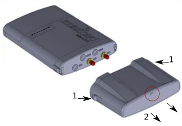
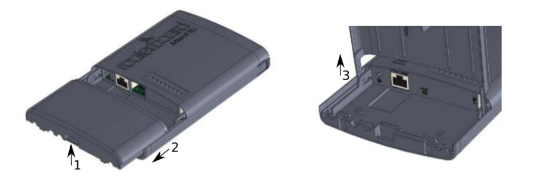
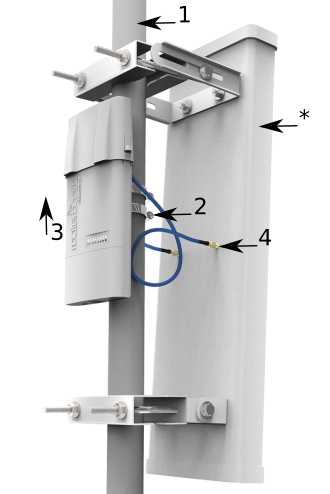
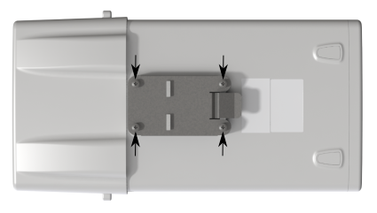
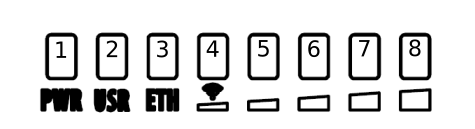
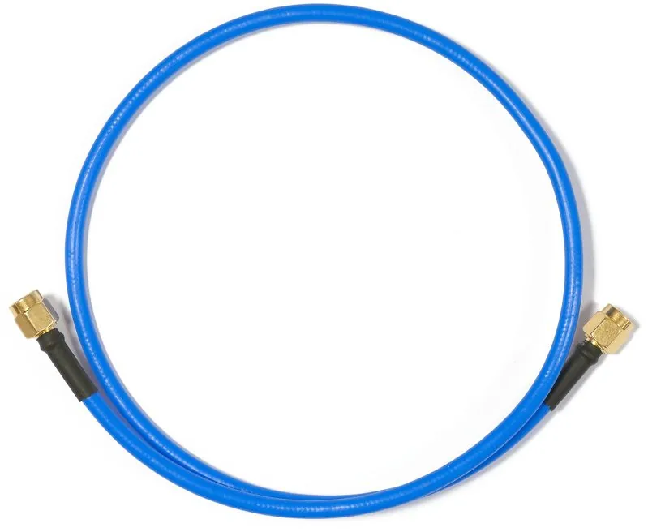

## [NetBox 5](https://mikrotik.com/product/RB911G-5HPacD-NB) (RB911G-5HPacD-NB)

## Safety Warnings

- Before you work on any equipment, be aware of the hazards involved with electrical circuitry, and be familiar with standard practices for preventing accidents.
- Ultimate disposal of this product should be handled according to all national laws and regulations.
- All installation methods for mounting an access point on any wall surface is subject to the acceptance of local jurisdiction.
- The Installation of the equipment must comply with local and national electrical codes.
- This product is intended to be mounted outdoors on a pole. Please read the mounting instructions carefully before beginning installation. Failure to use the correct hardware and configuration or to follow the correct procedures could result in a hazardous situation for people and damage to the system.
- Use only the power supply and accessories approved by the manufacturer, and which can be found in the original packaging of this product.
- Read the installation instructions before connecting the system to the power source.
- We cannot guarantee that no accidents or damage will occur due to the improper use of the device. Please use this product with care and operate at your own risk!
- In the case of device failure, please disconnect it from power. The fastest way to do so is by unplugging the power plug from the power outlet.
- It is the customer's responsibility to follow local country regulations, including operation within legal frequency channels, output power, cabling requirements, and Dynamic Frequency Selection (DFS) requirements. All MikroTik radio devices must be professionally installed.
- This is a class A device. In a domestic environment, this product might cause radio interference in which case the user might be required to take adequate measures.

**Exposure to Radio Frequency Radiation:** This MikroTik equipment complies with the FCC, IC, and European Union radiation exposure limits set forth for an uncontrolled environment. This MikroTik device should be installed and operated no closer than 20 centimeters from your body, occupational user, or the general public.

## Quickstart

Please follow these quick steps to set up your device:

- Remove the upper cover (see Removing upper cover);
- Connect an external antenna to the SMA connector (see Antenna usage);
- Open the bottom cover (see Opening bottom cover);
- Connect the device to the included PoE injector with an Ethernet cable to the data+power end;
- Connect the data end of the PoE injector to the computer;
- Connect the power adapter to the PoE injector;
- Connect to the device using the IP address received from your DHCP server. The username is "**admin**" with no password (or, for some models, check user and wireless passwords on the sticker), connected via **WebFig** or the **WinBox** tool;
- Configure the device, so it has an active Internet connection [https://mt.lv/configuration](https://mt.lv/configuration);
- For a manual update of the device, visit mikrotik.com, select your model, and locate the required packages in the "Downloads" section;
- Upload downloaded packages to the **WebFig** or **WinBox** "**Files**" menu and reboot the device;
- Updating your RouterOS software to the latest version will ensure the best performance, stability, and security updates;
- In the "QuickSet, PTP Bridge AP" menu set up the following: Choose your country, to apply country regulation settings;
- Set the antenna gain, depending on the antenna used;
- Set up your router password in the bottom field.

## Powering

The device accepts power in the following ways:

-

Ethernet port accepts Passive PoE 8-30 V DC ⎓. The power consumption under maximum load can reach 11.5 W. Connecting to a PoE Adapter:

-

Connect the Ethernet cable from the device to the PoE+DATA port of the PoE adapter.

-

Connect an Ethernet cable from your local network (LAN) to the PoE adapter.

-

Connect the power cord to the adapter, and then plug the power cord into a power outlet.

## Removing upper cover

- To remove the upper cover, press both side clips.
- Pull cover to the side while holding the body. When assembling please not mark on the top cover or reference.

## Opening bottom cover

- To open the bottom cover, press clip upwards to release.
- Pull cover slightly from the device body.

- Lift it, but do not remove it completely.

## Extension slots and ports

- Gigabit Ethernet port, supporting automatic cross/straight cable correction (Auto MDI/X). Either straight or crossover cable can be used for connecting to other network devices.
- External SMA antenna connectors.
- Integrated Wireless module operating at 5 GHz, 802.11a/n/ac protocol.

## Mounting

The Netbox 5 is designed to be used outdoors and mounted on a pole or DIN rail.When mounting, please ensure that the cable feed is pointing downwards. The IP rating scale of this device is IP54. We recommend using Cat6 shielded cables. Warning! This equipment should be installed and operated with a minimum distance of 240 cm between the device and your body. The operation of this equipment in the residential environment could cause radio interference. *Mounting and configuration of this device should be done by a qualified person.*

### Mounting on the pole

The Mounting hose clamp is provided with the package.

- Guide hose clamp through the opening on the back of the device and attach it to the mast.
- Align and secure with hose clamp screw using PH2 screwdriver.
- The device should be always placed by TOP cover facing upwards.
- Connect your antenna.

- The antenna is no provided with the device only for illustration purposes.

## Grounding

The installation infrastructure (towers and masts), must be properly grounded. Please secure all loose Ethernet cables and antenna cables to the pole or mast approximately 30cm from the device, so that the cable weight is not pulling the ports and connectors.

### Mounting using DIN rail

When mounting on the DIN rail, please find a special bracket in the package and secure it with four screws to the back of the unit. With the attached mounting bracket you will be able to slide the device on the DIN rail.

## Front status LED behavior

RouterOS allows configuring each LED's activity the way that the user wishes. It is possible to configure the LEDs to display wireless strength, blink the LEDs on interface traffic activity and many other options. For further information please visit the [LEDs](/docs/hardware/leds) manual page. Default factory configuration for this device:

- Solid Blue – The device is powered on.
- Solid Green – User-defined LED.
- Solid Green – Active Ethernet port.
-

- Solid Green – The set of five green LEDs, shows the signal strength.

## Configuration

We recommend clicking the "Check for updates" button in the QuickSet menu, as updating your RouterOS software to the latest version ensures the best performance and stability. Please make sure you have selected the country where the device will be used, to conform to local regulations. RouterOS includes many configuration options in addition to what is described in this document. We suggest starting here to get yourself accustomed to the possibilities: [https://mt.lv/help](https://mt.lv/help). In case an IP connection is not available, the WinBox tool ([https://mt.lv/winbox](https://mt.lv/winbox)) can be used to connect to the MAC address of the device from the LAN side (all access is blocked from the Internet port by default). Seek additional help from your local trainers or become a trainer of yourself. [https://mikrotik.com/training/about](https://mikrotik.com/training/about) For recovery purposes, it is possible to boot the device for reinstallation, see section .

## Reset button

The reset button has three functions:

- Hold this button during boot time until the LED light starts flashing, release the button to reset RouterOS configuration (total 5 seconds).
- Keep holding for 5 more seconds, LED turns solid, release now to turn on CAP mode. The device will now look for a CAPsMAN server (total 10 seconds).
- Or Keep holding the button for 5 more seconds until LED turns off, then release it to make the RouterBOARD look for Netinstall servers (total 15 seconds). Regardless of the above option used, the system will load the backup RouterBOOT loader if the button is pressed before power is applied to the device. Useful for RouterBOOT debugging and recovery.

## Accessories

The package includes the following accessories that come with the device:

- EU/US Switching Power Supply 24 V DC ⎓, 0.8 A, 19.2 W.
- Hose clamp 40/60 w2 A2 9 mm.
- 2pcs - Plastic tie strap fastener (300 mm(L) 7,6 mm(W)).
- Gigabit POE injector cable with shielded connector (RBGPOE).
- K-27 din-rail bracket mounting set.

## Antenna usage

To connect to the external antenna please use, the "Flex-guide" - can be obtained separately. A super low loss 50cm long RPSMA cable for superior connection quality, suited for indoor and outdoor use, this cable provides superior matching and loss values. [https://mikrotik.com/product/ACRPSMA](https://mikrotik.com/product/ACRPSMA) SMA connectors located under the upper cover (see Removing upper cover) to access them.

Please connect and disconnect the antenna, when the device is turned off!

See [Wireless Interface](/docs/wireless/abgn/wireless-interface) for configuration information.

## Specifications

For more information about this product, specifications, pictures, downloads, and test results please visit our web page: [https://mikrotik.com/product/RB911G-5HPacD-NB](https://mikrotik.com/product/RB911G-5HPacD-NB)

[https://i.mt.lv/cdn/product_files/NetBox_190842.pdf](https://i.mt.lv/cdn/product_files/NetBox_190842.pdf)

- RB911G-5HPacD-NB-US (USA) is factory locked for 5170-5250MHz and 5725-5835MHz frequencies. This lock can not be removed.
- RB911G-5HPacD-NB (International) supports the 5150MHz-5875MHz range (Specific frequency range can be limited by country regulations).

## Operating system support

The device supports RouterOS v7 and above. The specific factory-installed version is listed in /system resource. Other operating systems have not been tested.

To avoid pollution of the environment, please separate the device from household waste and dispose of it in a safe manner, such as in designated waste disposal sites. Familiarize yourself with the procedures for the proper transportation of the equipment to the designated disposal sites in your area.

## Federal Communication Commission Interference Statement

<table><thead><tr><th>Model</th><th>FCC ID</th></tr></thead><tbody><tr><td>RBDisc-5nD</td><td>TV7RB922-5HPACTM</td></tr></tbody></table>

This equipment has been tested and found to comply with the limits for a Class A digital device, pursuant to Part 15 of the FCC Rules. These limits are designed to provide reasonable protection against harmful interference in a commercial installation.

This equipment generates, uses, and can radiate radio frequency energy and, if not installed and used in accordance with the instruction manual, may cause harmful interference to radio communications. Operation of this equipment in a residential area is likely to cause harmful interference in which case the user will be required to correct the interference at his own expense.

**FCC Caution:** Any changes or modifications not expressly approved by the party responsible for compliance could void the user's authority to operate this equipment. This device complies with Part 15 of the FCC Rules. Operation is subject to the following two conditions: (1) This device may not cause harmful interference, and (2) this device must accept any interference received, including interference that may cause undesired operation. This device and its antenna must not be co-located or operation in conjunction with any other antenna or transmitter.

**IMPORTANT: Exposure to Radio Frequency Radiation.**

This equipment complies with the FCC RF radiation exposure limits set forth for an uncontrolled environment. This equipment should be installed and operated with a minimum distance of 20 cm between the radiator and any part of your body.

**Antenna Installation. WARNING:** It is the installer's responsibility to ensure that when using the authorized antennas in the United States (or where FCC rules apply); only those antennas certified with the product are used. The use of any antenna other than those certified with the product is expressly forbidden in accordance with FCC rules CRF47 part 15.204. The installer should configure the output power level of antennas, according to country regulations and per antenna type. *Professional installation is required for equipment with connectors to ensure compliance with health and safety issues.*

**List of approved 5GHz antennas:**

- 8.5 dBi Omni Directional (Model: MT-482016/N/A)
- 24 dBi Panel Antenna (Model: PA58-24-ANT)
- 32 dBi Dish Antenna (Model: HDDA5W-32-DP2) The same type of antenna and lower antenna gain than those listed above may also be used according to certification.

## Innovation, Science and Economic Development Canada

<table><thead><tr><th>Model</th><th>IC</th></tr></thead><tbody><tr><td>RBDisc-5nD</td><td>7442A-9225HPACT</td></tr></tbody></table>

This device complies with Industry Canada's license-exempt RSS standard(s). Operation is subject to the following two conditions: (1) this device may not cause interference, and (2) this device must accept any interference, including interference that may cause undesired operation of the device. Le présent appareil est conforme aux CNR d'Industrie Canada applicables aux appareils radio exempts de licence. L'exploitation est autorisée aux deux conditions suivantes : (1) l'appareil ne doit pas produire de brouillage, et (2) l'utilisateur de l'appareil doit accepter tout brouillage radioélectrique subi, même si le brouillage est susceptible d'en compromettre le fonctionnement.

The device for operation in the band 5150–5250 MHz is only for indoor use to reduce the potential for harmful interference to co-channel mobile satellite systems.

Les dispositifs fonctionnant dans la bande de 5 150 à 5 250 MHz sont réservés uniquement pour une utilisation à l'intérieur afin de réduire les risques de brouillage préjudiciable aux systèmes de satellites mobiles utilisant les mêmes canaux

This Class A digital apparatus complies with Canadian ICES-003.

Cet appareil numérique de la classe [A] est conforme à la norme NMB-003 du Canada.

CAN ICES-003 (A) / NMB-003 (A)

Antenna Installation WARNING: It is the installer's responsibility to ensure that when using the authorized antennas in Canada (or where IC rules apply); only those antennas certified with the product are to be used. The installer should configure the output power level of antennas, according to country regulations and per antenna type. Professional installation is required of equipment with connectors to ensure compliance with health and safety issues.

**IMPORTANT: Exposure to Radio Frequency Radiation.**

This equipment complies with the IC radiation exposure limits set forth for an uncontrolled environment. This equipment should be installed and operated with a minimum distance of 20 cm between the radiator and any part of your body.

**List of approved 5GHz antennas:**

- 8.5 dBi Omni Directional (Model: MT-482016/N/A)
- 24 dBi Panel Antenna (Model: PA58-24-ANT)
- 32 dBi Dish Antenna (Model: HDDA5W-32-DP2) The same type of antenna and lower antenna gain than those listed above may also be used according to certification.

## UKCA marking

## Eurasian Conformity Mark

<table><thead><tr><th>Частотный диапазон</th><th>Мощность передатчика</th></tr></thead><tbody><tr><td>5650-5850 МГц</td><td>≤100 мВт</td></tr></tbody></table>

*Доступные частотные каналы могут различаться в зависимости от модели продукта и сертификации.

Информация о дате изготовления устройства указана в конце серийного номера на его наклейке через дробь. Первая цифра означает номер года (последняя цифра года), две последующие означают номер недели.

Изготовитель: MikroTikls SIA, Aizkraukles iela 23, Riga, LV-1006, Латвия, [support@mikrotik.com](mailto:support@mikrotik.com). Сделано в Китае, Латвии или Литве. Cм. на упаковке.

Для получения подробных сведений о гарантийном обслуживании обратитесь к продавцу. Информация об импортерах продукции MikroTik в Российскую Федерацию: [https://mikrotik.com/buy/europe/russia](https://mikrotik.com/buy/europe/russia)

Продукты MikroTik, которые поставляются в Евразийский таможенный союз, оцениваются с учетом соответствующих требований и помечены знаком EAC, как показано ниже:

## Norma Oficial Mexicana

Rango de frecuencia (potencia de salida máxima): 5725-5850 MHz (30 dBm). Los canales de frecuencia disponibles pueden variar según el modelo y la certificación del producto.

EFICIENCIA ENERGETICA CUMPLE CON LA NOM-029-ENER-2017.

La operacion de este equipo esta sujeta a las siguientes dos condiciones:

- Es posible que este equipo o dispositivo no cause interferencia perjudicial y.
- Este equipo debe aceptar cualquier interferencia, incluyendo la que pueda causar su operacion no deseada. Fabricante: MikroTikls SIA, Brivibas gatve 214i, Riga, LV-1039, Latvia.

País De Origen: Letonia; Lituania; China (Republica Popular); Estados Unidos De America; Mexico.

Por favor contacte a su distribuidor local para preguntas regionales específicas. La lista de importadores se puede encontrar en nuestra página de inicio – [https://mikrotik.com/buy/latinamerica/mexico](https://mikrotik.com/buy/latinamerica/mexico).

## The National Commission for the State Regulation of Communications and Informatization by Ukraine

Виробник: MikroTikls SIA, Brivibas gatve 214i Рига, Латвія, LV1039.

Робоча частота (Максимальна вихідна потужність): 5470-5725 МГц (27 дБм).

Справжнім MikroTikls SIA заявляє, що маршрутизатор відповідає основним вимогам та іншим відповідним положенням директиви 2014/53/EC, а також суттєвим вимогам Технічного регламенту радіообладнання, затвердженого постановою Кабінету Міністрів України від 24 травня 2017 року № 355.

Для експлуатації в Україні необхідно отримати дозвіл на експлуатацію у порядку, затвердженому рішенням НКРЗІ від 01.11.2012 № 559, зареєстрованому в Міністерстві юстиції України 03.01.2013 за № 57/22589.

## CE Declaration of Conformity

Manufacturer: MikroTikls SIA, Brivibas gatve 214i Riga, Latvia, LV1039.

Hereby, Mikrotīkls SIA declares that the radio equipment type RB911G-5HPacD-NB is in compliance with Directive 2014/53/EU. The full text of the EU declaration of conformity is available at the following internet address: [https://mikrotik.com/products](https://mikrotik.com/products)

### Frequency bands terms of use

<table><thead><tr><th>Frequency range (for applicable models)</th><th>Channels used</th><th>Maximum Output Power (EIRP)</th><th>Restriction</th></tr></thead><tbody><tr><td>5470-5725 MHz</td><td>100 - 140</td><td>27 dBm</td><td>Without any restriction to use in all EU Member States</td></tr></tbody></table>

**It is the customer's responsibility to follow local country regulations, including operation within legal frequency channels, output power, cabling requirements, and Dynamic Frequency Selection (DFS) requirements. All MikroTik radio devices must be professionally installed!**

This MikroTik device meets Maximum WLAN transmit power limits per ETSI regulations. For more detailed information see Declaration of Conformity above / Dieses MikroTik-Gerät erfüllt die maximalen WLAN- Sendeleistung Grenzwerte gemäß ETSI-Bestimmungen. Weitere Informationen finden Sie oben unter Konformitätserklärung / Cet appareil MikroTik respecte les limites maximales de puissance de transmission WLAN conformément aux réglementations ETSI. Pour plus d'informations, voir la déclaration de conformité ci-dessus / Questo dispositivo MikroTik è conforme ai limiti massimi di potenza di trasmissione WLAN in conformità con le normative ETSI. Per ulteriori informazioni, consultare la dichiarazione di conformità sopra / Este dispositivo MikroTik cumple con los límites máximos de potencia de transmisión WLAN de acuerdo con las regulaciones ETSI. Para obtener más información, consulte la declaración de conformidad anterior / Это устройство MikroTik соответствует максимальным пределам мощности передачи WLAN в соответствии с правилами ETSI. Для получения дополнительной информации см. Декларацию соответствия выше.
