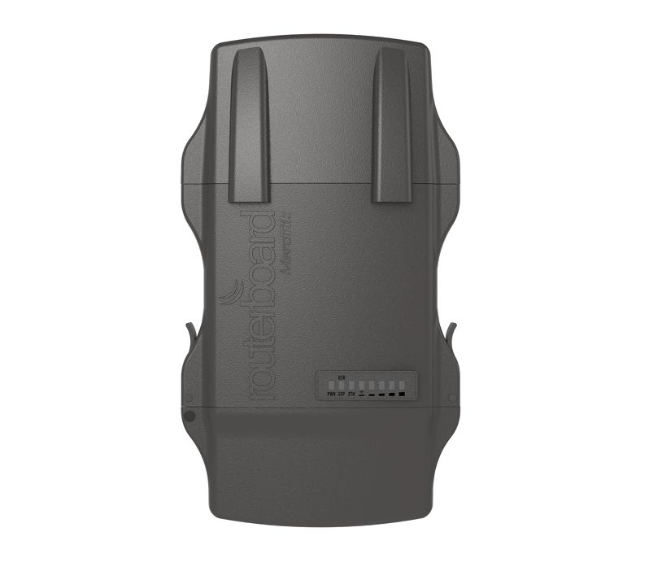
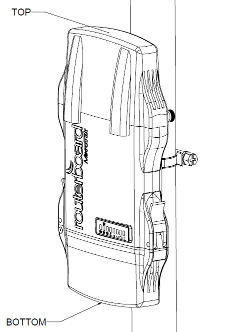
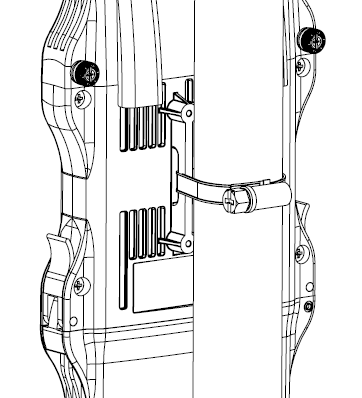
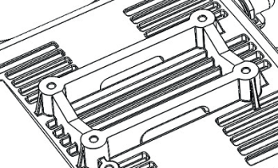

## [NetMetal 5](https://mikrotik.com/product/RB922UAGS-5HPacD-NM) (RB922UAGS-5HPacD-NM)

:::info This article covers

- **[NetMetal 5](https://mikrotik.com/product/RB922UAGS-5HPacD-NM)**
- **[NetMetal 5SHP](https://mikrotik.com/product/RB921UAGS-5SHPacD-NM)**
- **[NetMetal 5 triple](https://mikrotik.com/product/RB922UAGS-5HPacT-NM)**
- **[NetMetal 5SHP triple](https://mikrotik.com/product/RB921UAGS-5SHPacT-NM)**

:::

The NetMetal is a solid and waterproof outdoor device. It has a high power wireless interface, and one Gigabit Ethernet connector, which supports MDI-X auto-detection. The device has two or three RP-SMA connectors for connecting external antennas (depends on model). The device is packaged with a 24 V power adapter, a PoE injector, and two mounting loops. There are four models available – two Three-chain devices (with miniPCIe slot and without), and two Dual-chain models (with miniPCIe slot and without). Extra places for more RP-SMA connectors are available on the unit in this case.

## Quickstart

- Connect the device to the included PoE injector with an Ethernet cable to the data+power end;
- Connect the data end of the PoE injector to the computer;
- Connect the power adapter to the PoE injector;
- Configure your device using a web browser through **WebFig** or the **WinBox** tool at [https://mt.lv/winbox](https://mt.lv/winbox). **Multiple configuration methods are available to ensure accessibility;**
- Access **WebFig** by opening [https://192.168.88.1](https://192.168.88.1), and for **WinBox**, download the tool, navigate to the **Neighbors** tab, and click on the MAC address. The username is "**admin**" with no password (or, for some models, check user and wireless passwords on the sticker);
- DHCP Client enabled on the bridge;
- For a manual update of the device, visit mikrotik.com, select your model, and locate the required packages in the "Downloads" section;
- Upload downloaded packages to the **WebFig** or **WinBox** "**Files**" menu and reboot the device;
- Updating your RouterOS software to the latest version will ensure the best performance, stability, and security updates;
- In the "QuickSet, CPE" menu set up the following: Choose your country, to apply country regulation settings;
- Set the antenna gain, depending on the antenna used;
- Set up your router password in the bottom field.

## Mounting

The NetMetal is designed to be used outdoors and mounted on pole or DIN rail.

When mounting, please ensure that the cable feed is pointing downwards. The IP rating scale of this device is IP66. We recommend using Cat6 shielded cables. Warning! This equipment should be installed and operated with a minimum distance of 20 cm between the device and your body. Operation of this equipment in the residential environment could cause radio interference.Mounting and configuration of this device should be done by a qualified person.The mounting hose clamp is provided with the package.

- Guide hose clamp through the opening on the back of the device.
- Attach to the pole or mast.
- Align and secure by hose clamp screw using HEX3 screwdriver.
- The device should be always placed by TOP cover facing upwards.

- When mounting on the DIN rail, please find a special bracket in the package and secure it with four screws to the back of the unit.

- With the attached mounting bracket you will be able to slide the device on the DIN rail.

## Powering

The ethernet port accepts passive Power over Ethernet 8-30 V DC. The package contains a 24 V adapter and a PoE injector. The maximum power consumption of the device is 21 W at 24 V.

## Configuration

The device is configured as a bridge, with all interfaces bridged and DHCP Client enabled. RouterOS includes many configuration options in addition to what is described in this document. We suggest starting here to get yourself accustomed to the possibilities: [https://mt.lv/help](https://mt.lv/help) In case IP connection is not available, the WinBox tool ([https://mt.lv/winbox](https://mt.lv/winbox)) can be used to connect to the MAC address of the device from the LAN side (all access is blocked from the internet port by default).

## Extension slots and ports

- Built-in 5GHz 802.11ac/a/n wireless, AP/station/bridge modes supported (for CPE, AP, PtP modes)
- One 10/100/1000 Gigabit Ethernet port, supporting automatic cross/straight cable correction (Auto MDI/X), so you can use either straight or crossover cable for connecting to other network devices. The Ethernet port accepts 8-30 V DC powering from a passive PoE injector.
- One USB 2.0 or 3.0 port (depends on model) for extra storage or 3G/4G modem

## Buttons and jumpers

The reset button has three functions:

- Hold this button during boot time until the LED light starts flashing, release the button to reset RouterOS configuration (total 5 seconds).
- Keep holding for 5 more seconds, LED turns solid, release now to turn on CAPs mode for managing the unit from a CAPsMAN server (total 10 seconds).
- Or Keep holding the button for 5 more seconds until LED turns off, then release it to make the RouterBOARD look for Netinstall servers (total 15 seconds).

## Operating system support

The device supports RouterOS v7 and above. The specific factory-installed version is listed in /system resource. Other operating systems have not been tested. We recommend clicking the "Check for updates" button and updating your RouterOS software to the latest version to ensure the best performance and stability.

To avoid pollution of the environment, please separate the device from household waste and dispose of it in a safe manner, such as in designated waste disposal sites. Familiarize yourself with the procedures for the proper transportation of the equipment to the designated disposal sites in your area.

## Federal Communication Commission Interference Statement

This equipment has been tested and found to comply with the limits for a Class A digital device, pursuant to Part 15 of the FCC Rules. These limits are designed to provide reasonable protection against harmful interference in a commercial installation.

This equipment generates, uses, and can radiate radio frequency energy and, if not installed and used in accordance with the instruction manual, may cause harmful interference to radio communications. Operation of this equipment in a residential area is likely to cause harmful interference in which case the user will be required to correct the interference at his own expense.

FCC Caution: Any changes or modifications not expressly approved by the party responsible for compliance could void the user’s authority to operate this equipment.

This device complies with Part 15 of the FCC Rules. Operation is subject to the following two conditions: (1) This device may not cause harmful interference, and (2) this device must accept any interference received, including interference that may cause undesired operation.

Note: This unit was tested with shielded cables on the peripheral devices. Shielded cables must be used with the unit to ensure compliance.

Antenna Installation WARNING: It is the installer's responsibility to ensure that when using the authorized antennas in the USA (or where FCC rules apply); only those antennas certified with the product are to be used. The installer should configure the output power level of antennas, according to country regulations and per antenna type. Professional installation is required for equipment with connectors to ensure compliance with health and safety issues.

Approved Antenna Table:

<table><thead><tr><th>Antenna Model</th><th>Type</th><th>Antenna gain, dBi</th></tr></thead><tbody><tr><td>**UNII-1 (5150-5250 MHz) and UNII-3 (5725-5850MHz)**</td><td></td><td></td></tr><tr><td>MT-482016/N/A</td><td>Omnidirectional</td><td>8.5</td></tr><tr><td>PA58-24-ANT</td><td>Panel</td><td>24</td></tr><tr><td>HDDA5W-32-DP2</td><td>Dish</td><td>32</td></tr><tr><td>**UNII-2A (5250-5350 MHz) and UNII-2C (5470-5725MHz)**</td><td></td><td></td></tr><tr><td>HGO-antenna-OUT</td><td>Omnidirectional</td><td>7</td></tr><tr><td>MTAS-5G-19D120</td><td>Sector</td><td>19</td></tr></tbody></table>

**The same type of antenna and lower antenna gain than those listed above in the table may also be used in accordance with certification.*

## Innovation, Science and Economic Development Canada

This device contains license-exempt transmitter(s)/receiver(s) that comply with Innovation, Science, and Economic Development Canada’s license-exempt RSS(s). Operation is subject to the following two conditions: (1) This device may not cause interference. (2) This device must accept any interference, including interference that may cause undesired operation of the device.

L’émetteur/récepteur exempt de licence contenu dans le présent appareil est conforme aux CNR d’Innovation, Sciences et Développement économique Canada applicables aux appareils radio exempts de licence. L’exploitation est autorisée aux deux conditions suivantes : 1) L’appareil ne doit pas produire de brouillage; 2) L’appareil doit accepter tout brouillage radioélectrique subi, même si le brouillage est susceptible d’en compromettre le fonctionnement.

This Class A digital apparatus complies with Canadian ICES-003.

Cet appareil numérique de la classe [A] est conforme à la norme NMB-003 du Canada.

CAN ICES-003 (A) / NMB-003 (A)

The device for operation in the band 5150–5250 MHz is only for indoor use to reduce the potential for harmful interference to co-channel mobile satellite systems.

Les dispositifs fonctionnant dans la bande de 5 150 à 5 250 MHz sont réservés uniquement pour une utilisation à l'intérieur afin de réduire les risques de brouillage préjudiciable aux systèmes de satellites mobiles utilisant les mêmes canaux.

Antenna Installation WARNING: It is the installer's responsibility to ensure that when using the authorized antennas in Canada (or where IC rules apply); only those antennas certified with the product are to be used. The installer should configure the output power level of antennas, according to country regulations and per antenna type. Professional installation is required for equipment with connectors to ensure compliance with health and safety issues.

Approved Antenna Table:

<table><thead><tr><th>Antenna Model</th><th>Type</th><th>Antenna gain, dBi</th></tr></thead><tbody><tr><td>**UNII-1 (5150-5250 MHz) and UNII-3 (5725-5850MHz)**</td><td></td><td></td></tr><tr><td>MT-482016/N/A</td><td>Omnidirectional</td><td>8.5</td></tr><tr><td>PA58-24-ANT</td><td>Panel</td><td>24</td></tr><tr><td>HDDA5W-32-DP2</td><td>Dish</td><td>32</td></tr><tr><td>**UNII-2 (5250-5350 MHz) and UNII-2-Extended (5490-5600 MHz, 5650-5730 MHz)**</td><td></td><td></td></tr><tr><td>HGO-antenna-OUT</td><td>Omnidirectional</td><td>7</td></tr><tr><td>MTAS-5G-19D120</td><td>Sector</td><td>19</td></tr></tbody></table>

**The same type of antenna and lower antenna gain than those listed above may also be used in accordance with certification.*

## UKCA marking

## Eurasian Conformity Mark

<table><thead><tr><th>Частотный диапазон</th><th>Мощность передатчика</th></tr></thead><tbody><tr><td>5150-5350 МГц, 5650-5850 МГц</td><td>≤100 мВт</td></tr></tbody></table>

*Доступные частотные каналы могут различаться в зависимости от модели продукта и сертификации.

Информация о дате изготовления устройства указана в конце серийного номера на его наклейке через дробь. Первая цифра означает номер года (последняя цифра года), две последующие означают номер недели.

Изготовитель: MikroTikls SIA, Aizkraukles iela 23, Riga, LV-1006, Латвия, [support@mikrotik.com](mailto:support@mikrotik.com). Сделано в Китае, Латвии или Литве. Cм. на упаковке.

Для получения подробных сведений о гарантийном обслуживании обратитесь к продавцу. Информация об импортерах продукции MikroTik в Российскую Федерацию: [https://mikrotik.com/buy/europe/russia](https://mikrotik.com/buy/europe/russia)

Продукты MikroTik, которые поставляются в Евразийский таможенный союз, оцениваются с учетом соответствующих требований и помечены знаком EAC, как показано ниже:

## Norma Oficial Mexicana

Rango de frecuencia (potencia de salida máxima): 5725-5850 MHz (30 dBm). Los canales de frecuencia disponibles pueden variar según el modelo y la certificación del producto.

EFICIENCIA ENERGETICA CUMPLE CON LA NOM-029-ENER-2017.

La operacion de este equipo esta sujeta a las siguientes dos condiciones:

- Es posible que este equipo o dispositivo no cause interferencia perjudicial y.
- Este equipo debe aceptar cualquier interferencia, incluyendo la que pueda causar su operacion no deseada. Fabricante: MikroTikls SIA, Brivibas gatve 214i, Riga, LV-1039, Latvia.

País De Origen: Letonia; Lituania; China (Republica Popular); Estados Unidos De America; Mexico.

Por favor contacte a su distribuidor local para preguntas regionales específicas. La lista de importadores se puede encontrar en nuestra página de inicio – [https://mikrotik.com/buy/latinamerica/mexico](https://mikrotik.com/buy/latinamerica/mexico).

## The National Commission for the State Regulation of Communications and Informatization by Ukraine

Виробник: MikroTikls SIA, Brivibas gatve 214i Рига, Латвія, LV1039.

Робоча частота (Максимальна вихідна потужність): 5150-5250 МГц (23 дБм), 5250-5350 МГц (20 дБм), 5470-5725 МГц (27 дБм).

Справжнім MikroTikls SIA заявляє, що маршрутизатор відповідає основним вимогам та іншим відповідним положенням директиви 2014/53/EC, а також суттєвим вимогам Технічного регламенту радіообладнання, затвердженого постановою Кабінету Міністрів України від 24 травня 2017 року № 355.

Для експлуатації в Україні необхідно отримати дозвіл на експлуатацію у порядку, затвердженому рішенням НКРЗІ від 01.11.2012 № 559, зареєстрованому в Міністерстві юстиції України 03.01.2013 за № 57/22589.

## CE Declaration of Conformity

Manufacturer: MikroTikls SIA, Brivibas gatve 214i Riga, Latvia, LV1039.

Hereby, Mikrotīkls SIA declares that the radio equipment type RouterBOARD is in compliance with Directive 2014/53/EU. The full text of the EU declaration of conformity is available at the following internet address: [https://mikrotik.com/products](https://mikrotik.com/products)

### WLAN

<table><thead><tr><th>Operating Frequency / Maximum output power Betriebsfrequenz / maximale Ausgangsleistung Fréquence de fonctionnement / puissance de sortie maximale Frequenza operativa / massima potenza di uscita Frecuencia de funcionamiento / potencia de salida máxima Рабочая частота / максимальная выходная мощность</th><th>5470-5725 MHz / 27 dBm</th></tr></thead></table>

This MikroTik device meets Maximum TX power limits per ETSI regulations. For more detailed information see Declaration of Conformity above / Dieses MikroTik-Gerät erfüllt die maximalen Sendeleistungsgrenzwerte gemäß ETSI-Bestimmungen. Weitere Informationen finden Sie oben in der Konformitätserklärung. Nähere Informationen finden Sie oben in der Konformitätserklärung / Cet appareil MikroTik respecte les limites de puissance TX maximale via les réglementations ETSI. Pour plus d'informations, voir la déclaration de conformité ci-dessus / Questo dispositivo MikroTik soddisfa i limiti di potenza massima TX tramite le normative ETSI. Per informazioni più dettagliate consultare la Dichiarazione di conformità sopra / Este dispositivo MikroTik cumple con los límites máximos de potencia TX a través de las normas ETSI. Para obtener información más detallada, consulte la Declaración de conformidad anterior / Это устройство MikroTik соответствует ограничениям максимальной мощности передачи согласно правилам ETSI. Для получения более подробной информации см. Декларацию соответствия выше.
