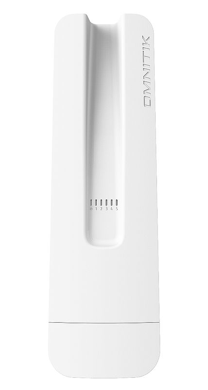
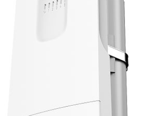

:::info This article covers

- **[OmniTIK 5 ac](https://mikrotik.com/product/rbomnitikg_5hacd)** (RBOmniTikG-5HacD)
- **[OmniTIK 5 PoE ac](https://mikrotik.com/product/rbomnitikpg_5hacd)** (RBOmniTikPG-5HacD)
- **[OmniTIK 5 PoE](https://mikrotik.com/product/RBOmniTikUPA-5HnDr2)** (RBOmniTikUPA-5HnD)
- **[OmniTIK 5](https://mikrotik.com/product/RBOmniTikU-5HnDr2)** (RBOmniTikU-5HnD)

:::

This device needs to be upgraded to RouterOS v7.11.2 or the latest version to ensure compliance with local authority regulations. It is the end users' responsibility to follow local country regulations, including operation within legal frequency channels, output power, cabling requirements, and Dynamic Frequency Selection (DFS) requirements. All MikroTik radio devices must be professionally installed.

*Technical specifications, brochures, and more info about products at [https://mikrotik.com/products](https://mikrotik.com/products)* *Configuration manual for software with additional information can be found at [https://mt.lv/help](https://mt.lv/help)*

*MikroTik devices are for professional use, if you do not have qualifications please seek a consultant [https://mikrotik.com/consultants](https://mikrotik.com/consultants)*

## Safety Warnings

- Before you work on any equipment, be aware of the hazards involved with electrical circuitry, and be familiar with standard practices for preventing accidents.
- Ultimate disposal of this product should be handled according to all national laws and regulations.
- All installation methods for mounting an access point on any wall surface is subject to the acceptance of local jurisdiction.
- The Installation of the equipment must comply with local and national electrical codes.
- This product is intended to be mounted outdoors on a pole. Please read the mounting instructions carefully before beginning installation. Failure to use the correct hardware and configuration or to follow the correct procedures could result in a hazardous situation for people and damage to the system.
- Use only the power supply and accessories approved by the manufacturer, and which can be found in the original packaging of this product.
- Read the installation instructions before connecting the system to the power source.
- We cannot guarantee that no accidents or damage will occur due to the improper use of the device. Please use this product with care and operate at your own risk!
- In the case of device failure, please disconnect it from power. The fastest way to do so is by unplugging the power plug from the power outlet.
- It is the customer's responsibility to follow local country regulations, including operation within legal frequency channels, output power, cabling requirements, and Dynamic Frequency Selection (DFS) requirements. All MikroTik radio devices must be professionally installed.
- This is a class A device. In a domestic environment, this product might cause radio interference in which case the user might be required to take adequate measures.

**IMPORTANT: Exposure to Radio Frequency Radiation.**

- This equipment complies with the IC radiation exposure limits set forth for an uncontrolled environment. This equipment should be installed and operated with a minimum distance of 30 cm between the radiator and any part of your body.

## First use

First Ethernet is always configured as a WAN port (protected by a firewall, enabled DHCP client, and disabled MAC connection/discovery). Other Ethernet ports and wireless interfaces are added to the local LAN bridge with 192.168.88.1/24 address set and configured DHCP server.

- Open the bottom lid.
- Connect your PC or LAN cables to the Ethernet ports.
- Connect power source as described in the Powering section.
- Set LAN computer IP configuration to automatic (DHCP).
- The Default IP address of the unit is 192.168.88.1, open this address in your web browser to start the configuration. The username is admin and there is no password (or, for some models, check user and wireless passwords on the sticker).
- We recommend clicking the "Check for updates" button and updating your RouterOS software to the latest version to ensure the best performance and stability.
- Choose your country, apply country regulation settings and set up your password on the screen that loads. We recommend clicking the "Check for updates" button and updating your RouterOS software to the latest version to ensure the best performance and stability. RouterOS includes many configuration options in addition to what is described in this document. We suggest visiting the RouterOS documentation page to get yourself accustomed to the possibilities: [https://mt.lv/help](https://mt.lv/help) In case an IP connection is not available, the WinBox tool ([https://mt.lv/winbox](https://mt.lv/winbox)) can be used to connect to the MAC address of the device from the LAN side (all access is blocked from the internet port by default).

## Powering

The device accepts power in the following ways:

- Ethernet port accepts passive PoE 12-57 V DC ⎓. For Omnitik 5 models, 11-30 V. The power consumption under maximum load can reach 14 W. PoE version accepts 12-57 V DC with a maximum consumption of 18W, with attachments 66 W.

### Connecting to a PoE Adapter

- Connect the Ethernet cable from the device to the PoE+DATA port of the PoE adapter;
- Connect an Ethernet cable from your local network (LAN) to the PoE adapter;
- Connect the power cord to the adapter, and then plug the power cord into a power outlet.

## Power output

*Applies only to OmniTik 5 PoE ac:* This device can supply PoE power to external devices from its Ethernet ports. This is convenient as you don't need any additional PoE injectors to power other devices. The output voltage will be the same as the input voltage. The maximum power output of each Ethernet port in this mode is 1A (the total maximum for all ports is 2A). To reach maximum output power it is recommended to use a high voltage adapter together with the included PoE injector to power the OmniTik unit (48/56V), because 802.3af/at the input is limited to 30W and OmniTik will consume up to 15W by itself. Once Power Output is enabled in RouterOS, the Ethernet LED adds red color to it (green means Ethernet link is made, red means power but no link, red and green both means there is link and power).

## Mounting

On the back of the device, slide the included pole mount adapter with the clip facing forward, until the clip clicks into place.

## [OmniTIK 5 PoE ac](https://mikrotik.com/product/rbomnitikpg_5hacd) (RBOmniTikPG-5HacD)

Use the included hose clamp to attach the unit to a pole or mast. Adjustable QuickMount adapters are available separately.

The OmniTik has a locking screw that secures the port door, it can be closed with a 5mm hex screwdriver.

## Grounding

The installation infrastructure (towers and masts), must be properly grounded. Please secure all loose Ethernet cables and antenna cables to the pole or mast approximately 30cm from the device, so that the cable weight is not pulling the ports and connectors.

## Extension slots and ports

- Five Gigabit Ethernet ports, supporting automatic cross/straight cable correction (Auto MDI/X), so you can use either straight or cross-over cables for connecting to other network devices.
- One integrated wireless 5GHz 802.11a/n/ac, 2x2 MIMO with built in grid antenna, max gain 7.5dBi.

## Buttons and jumpers

The reset button has the following functions:

- Hold this button during boot time until the LED light starts flashing, release the button to reset RouterOS configuration (total 5 seconds).
- Keep holding for 5 more seconds, LED turns solid, release now to turn on CAP mode. The device will now look for a CAPsMAN server (total 10 seconds).
- Or Keep holding the button for 5 more seconds until LED turns off, then release it to make the RouterBOARD look for Netinstall servers (total 15 seconds). Regardless of the above option used, the system will load the backup RouterBOOT loader if the button is pressed before power is applied to the device. Useful for RouterBOOT debugging and recovery.

## Operating system support

The device supports RouterOS v7 and above. The specific factory-installed version is listed in /system resource. Other operating systems have not been tested.

To avoid pollution of the environment, please separate the device from household waste and dispose of it in a safe manner, such as in designated waste disposal sites. Familiarize yourself with the procedures for the proper transportation of the equipment to the designated disposal sites in your area.

## Federal Communication Commission Interference Statement

<table><thead><tr><th>Model</th><th>FCC ID</th></tr></thead><tbody><tr><td>RBOmniTikG-5HacD</td><td>TV7OMNITIKPG5HACD</td></tr><tr><td>RBOmniTikPG-5HacD</td><td>TV7OMNITIKPG5HACD</td></tr><tr><td>RBOmniTikUPA-5HnD</td><td>TV7RBOMNITIK5HND</td></tr><tr><td>RBOmniTikU-5HnD</td><td>TV7RBOMNITIK5HND</td></tr></tbody></table>

This equipment has been tested and found to comply with the limits for a Class A digital device, pursuant to Part 15 of the FCC Rules. These limits are designed to provide reasonable protection against harmful interference in a commercial installation.

This equipment generates, uses, and can radiate radio frequency energy and, if not installed and used in accordance with the instruction manual, may cause harmful interference to radio communications. Operation of this equipment in a residential area is likely to cause harmful interference in which case the user will be required to correct the interference at his own expense.

**FCC Caution:** Any changes or modifications not expressly approved by the party responsible for compliance could void the user's authority to operate this equipment. This device complies with Part 15 of the FCC Rules. Operation is subject to the following two conditions: (1) This device may not cause harmful interference, and (2) this device must accept any interference received, including interference that may cause undesired operation. This device and its antenna must not be co-located or operation in conjunction with any other antenna or transmitter.

**IMPORTANT: Exposure to Radio Frequency Radiation.**

This equipment complies with the IC radiation exposure limits set forth for an uncontrolled environment. This equipment should be installed and operated with a minimum distance of 20 cm between the radiator and any part of your body.

**Antenna Installation. WARNING:** It is the installer's responsibility to ensure that when using the authorized antennas in the United States (or where FCC rules apply); only those antennas certified with the product are used. The use of any antenna other than those certified with the product is expressly forbidden in accordance with FCC rules CFR47 part 15.204. The installer should configure the output power level of antennas, according to country regulations and per antenna type. Professional installation is required for equipment with connectors to ensure compliance with health and safety issues.

**LIST OF APPROVED 5 GHz ANTENNAS:**

- 8.5 dBi Omni Directional (Model: MT-482016/N/A);
- 24 dBi Panel Antenna (Model: PA58-24-ANT);
- 32 dBi Dish Antenna (Model: HDDA5W-32-DP2); The same type of antenna and lower antenna gain than those listed above may also be used in accordance with certification.

## Innovation, Science and Economic Development Canada

<table><thead><tr><th>Model</th><th>IC</th></tr></thead><tbody><tr><td>RBOmniTikG-5HacD</td><td>7442A-OMNTKPG5AC</td></tr><tr><td>RBOmniTikPG-5HacD</td><td>7442A-OMNTKPG5AC</td></tr><tr><td>RBOmniTikUPA-5HnD</td><td>7442A-OMNTK5HND</td></tr><tr><td>RBOmniTikU-5HnD</td><td>7442A-OMNTK5HND</td></tr></tbody></table>

This device complies with Industry Canada's license-exempt RSS standard(s). Operation is subject to the following two conditions: (1) this device may not cause interference, and (2) this device must accept any interference, including interference that may cause undesired operation of the device. Le présent appareil est conforme aux CNR d'Industrie Canada applicables aux appareils radio exempts de licence. L'exploitation est autorisée aux deux conditions suivantes : (1) l'appareil ne doit pas produire de brouillage, et (2) l'utilisateur de l'appareil doit accepter tout brouillage radioélectrique subi, même si le brouillage est susceptible d'en compromettre le fonctionnement.

This Class A digital apparatus complies with Canadian ICES-003.

Cet appareil numérique de la classe [A] est conforme à la norme NMB-003 du Canada.

CAN ICES-003 (A) / NMB-003 (A)

The device for operation in the band 5150–5250 MHz is only for indoor use to reduce the potential for harmful interference to co-channel mobile satellite systems.

Les dispositifs fonctionnant dans la bande de 5 150 à 5 250 MHz sont réservés uniquement pour une utilisation à l'intérieur afin de réduire les risques de brouillage préjudiciable aux systèmes de satellites mobiles utilisant les mêmes canaux

**IMPORTANT: Exposure to Radio Frequency Radiation.**

This equipment complies with the IC radiation exposure limits set forth for an uncontrolled environment. This equipment should be installed and operated with a minimum distance of 20 cm between the radiator and any part of your body.

**Antenna Installation WARNING:** It is the installer's responsibility to ensure that when using the authorized antennas in Canada (or where IC rules apply); only those antennas certified with the product are to be used. The installer should configure the output power level of antennas, according to country regulations and per antenna type. Professional installation is required of equipment with connectors to ensure compliance with health and safety issues.

**LIST OF APPROVED 5 GHz ANTENNAS:**

- 8.5 dBi Omni Directional (Model: MT-482016/N/A)
- 24 dBi Panel Antenna (Model: PA58-24-ANT)
- 32 dBi Dish Antenna (Model: HDDA5W-32-DP2) The same type of antenna and lower antenna gain than those listed above may also be used in accordance with certification.

## UKCA marking

## Eurasian Conformity Mark

<table><thead><tr><th>Частотный диапазон</th><th>Мощность передатчика</th></tr></thead><tbody><tr><td>5150-5350 МГц, 5650-5850 МГц</td><td>≤100 мВт</td></tr></tbody></table>

*Доступные частотные каналы могут различаться в зависимости от модели продукта и сертификации.

Информация о дате изготовления устройства указана в конце серийного номера на его наклейке через дробь. Первая цифра означает номер года (последняя цифра года), две последующие означают номер недели.

Изготовитель: MikroTikls SIA, Aizkraukles iela 23, Riga, LV-1006, Латвия, [support@mikrotik.com](mailto:support@mikrotik.com). Сделано в Китае, Латвии или Литве. Cм. на упаковке.

Для получения подробных сведений о гарантийном обслуживании обратитесь к продавцу.

Продукты MikroTik, которые поставляются в Евразийский таможенный союз, оцениваются с учетом соответствующих требований и помечены знаком EAC, как показано ниже:

## Norma Oficial Mexicana

Rango de frecuencia (potencia de salida máxima): 5725-5850 MHz (30 dBm). Los canales de frecuencia disponibles pueden variar según el modelo y la certificación del producto.

EFICIENCIA ENERGETICA CUMPLE CON LA NOM-029-ENER-2017.

La operacion de este equipo esta sujeta a las siguientes dos condiciones:

- Es posible que este equipo o dispositivo no cause interferencia perjudicial y.
- Este equipo debe aceptar cualquier interferencia, incluyendo la que pueda causar su operacion no deseada. Fabricante: MikroTikls SIA, Unijas iela 2, Riga, LV-1039, Latvia.

País De Origen: Letonia; Lituania; China (Republica Popular); Estados Unidos De America; Mexico.

Por favor contacte a su distribuidor local para preguntas regionales específicas. La lista de importadores se puede encontrar en nuestra página de inicio – [https://mikrotik.com/buy/latinamerica/mexico](https://mikrotik.com/buy/latinamerica/mexico).

## The National Commission for the State Regulation of Communications and Informatization by Ukraine

Виробник: MikroTikls SIA, Unijas iela 2, Рига, Латвія, LV1039.

Робоча частота (Максимальна вихідна потужність): 5470-5725 МГц (27 дБм).

Справжнім MikroTikls SIA заявляє, що маршрутизатор відповідає основним вимогам та іншим відповідним положенням директиви 2014/53/EC, а також суттєвим вимогам Технічного регламенту радіообладнання, затвердженого постановою Кабінету Міністрів України від 24 травня 2017 року № 355.

Для експлуатації в Україні необхідно отримати дозвіл на експлуатацію у порядку, затвердженому рішенням НКРЗІ від 01.11.2012 № 559, зареєстрованому в Міністерстві юстиції України 03.01.2013 за № 57/22589.

## CE Declaration of Conformity

Manufacturer: MikroTikls SIA, Unijas iela 2. Riga, Latvia, LV1039.

Hereby, Mikrotīkls SIA declares that the radio equipment type RouterBOARD is in compliance with Directive 2014/53/EU. The full text of the EU declaration of conformity is available at the following internet address: [https://mikrotik.com/products](https://mikrotik.com/products)

### Frequency bands terms of use

<table><thead><tr><th>**Frequency range (for applicable models)**</th><th>**Channels used**</th><th>**Maximum Output Power (EIRP)**</th><th>**Restriction**</th></tr></thead><tbody><tr><td>5470-5725 MHz</td><td>100 - 140</td><td>27 dBm</td><td>Without any restriction to use in all EU Member States</td></tr></tbody></table>

**It is the customer's responsibility to follow local country regulations, including operation within legal frequency channels, output power, cabling requirements, and Dynamic Frequency Selection (DFS) requirements. All MikroTik radio devices must be professionally installed!**

This MikroTik device meets Maximum WLAN transmit power limits per ETSI regulations. For more detailed information see Declaration of Conformity above / Dieses MikroTik-Gerät erfüllt die maximalen WLAN- Sendeleistung Grenzwerte gemäß ETSI-Bestimmungen. Weitere Informationen finden Sie oben unter Konformitätserklärung / Cet appareil MikroTik respecte les limites maximales de puissance de transmission WLAN conformément aux réglementations ETSI. Pour plus d'informations, voir la déclaration de conformité ci-dessus / Questo dispositivo MikroTik è conforme ai limiti massimi di potenza di trasmissione WLAN in conformità con le normative ETSI. Per ulteriori informazioni, consultare la dichiarazione di conformità sopra / Este dispositivo MikroTik cumple con los límites máximos de potencia de transmisión WLAN de acuerdo con las regulaciones ETSI. Para obtener más información, consulte la declaración de conformidad anterior / Это устройство MikroTik соответствует максимальным пределам мощности передачи WLAN в соответствии с правилами ETSI. Для получения дополнительной информации см. Декларацию соответствия выше.
