### LoRa card installation

LtAP LTE kit will be used as an example in this section.

Open your router's case. For LtAP specifically, once you have removed all the screws, carefully move the upper case to the left side, as the LTE antennas are attached to the inner side of it:

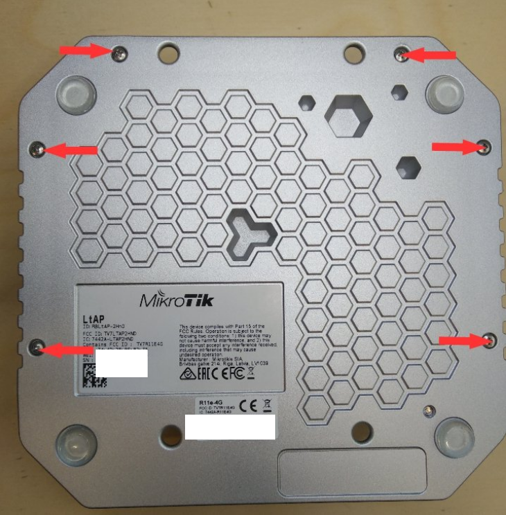

Insert R11e-LoRa card into the mini-PCIe slot and apply two screws to the threaded inserts:

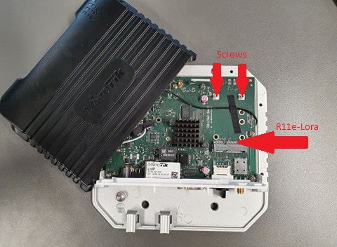

Attach antenna to the card (UFL connector). In this case UFL → SMA cable is also used, as the LtAP's case has a specific slot for it.

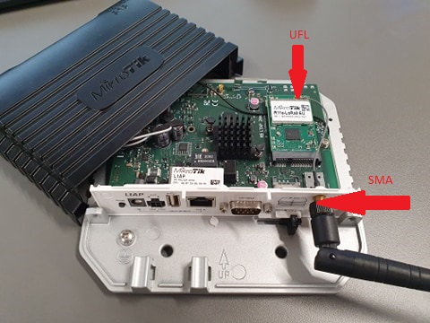

Once the previous steps are done, you can close the router's case and move on to configuration.

### Configuration

#### GUI setup

Connect to your router via Winbox or WebFig.

Winbox can be downloaded from the [link](https://mikrotik.com/download/winbox).

Run it:

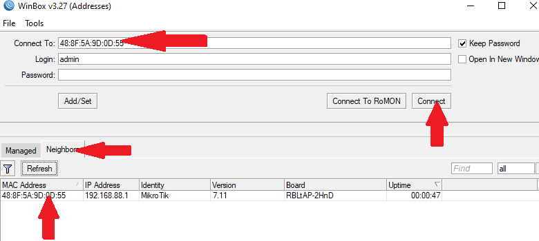

It is highly recommended to upgrade your RouterOS version to the latest available. Installing the version will perform a reboot:

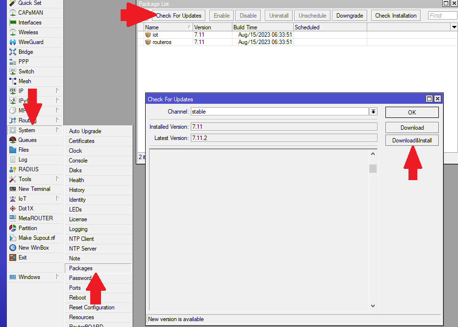

If your device does not have the **IoT>LoRa** menu, download "**Extra packages**" specifically for your router's architecture and rOS version. You can see the type of your router's architecture at the top of the Winbox window or in System →  Resources → Architecture Name.
[https://mikrotik.com/download](https://mikrotik.com/download)
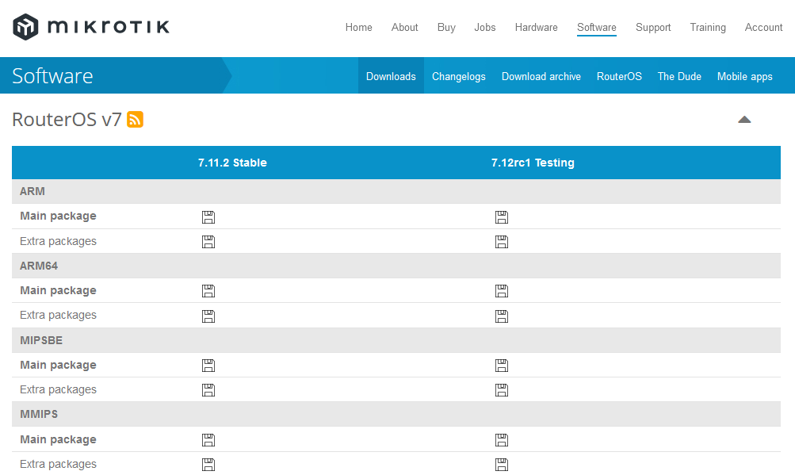

Once the package is downloaded and extracted, upload the **IoT** package to your router. It can be done via drag & drop as well. It should appear in the files folder after the upload is complete. Reboot your router (System → Reboot) to install the package:
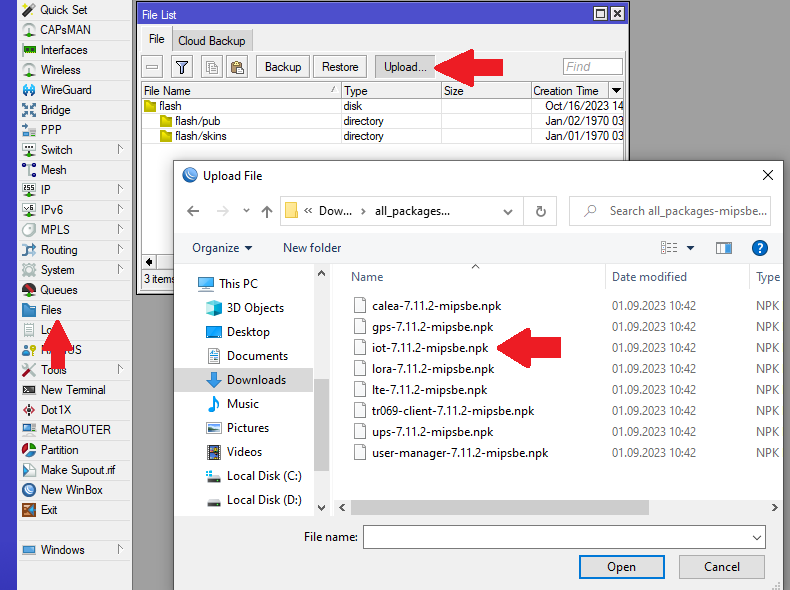

After the reboot, the package should be visible in the Package list:
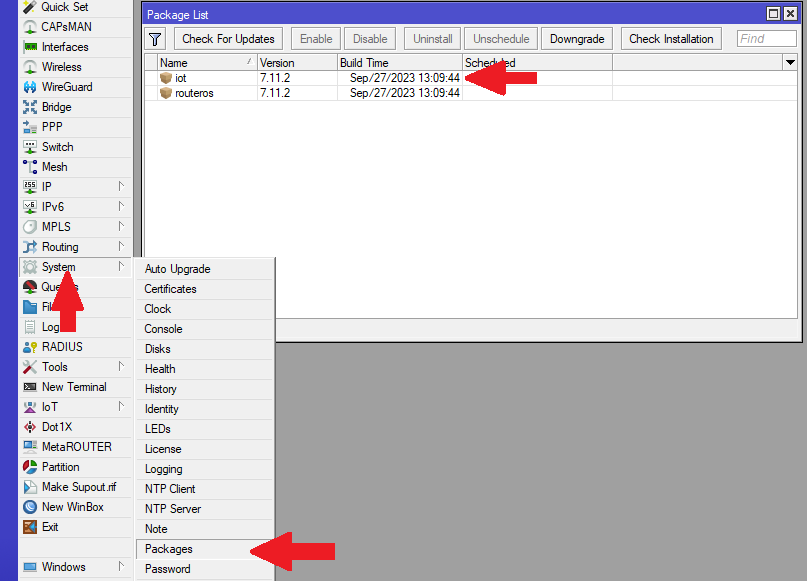

Check if the LoRa gateway has initialized under **IoT>LoRa>Devices**. If it is an LtAP model, make sure to set USB Type to Mini-PCIe:
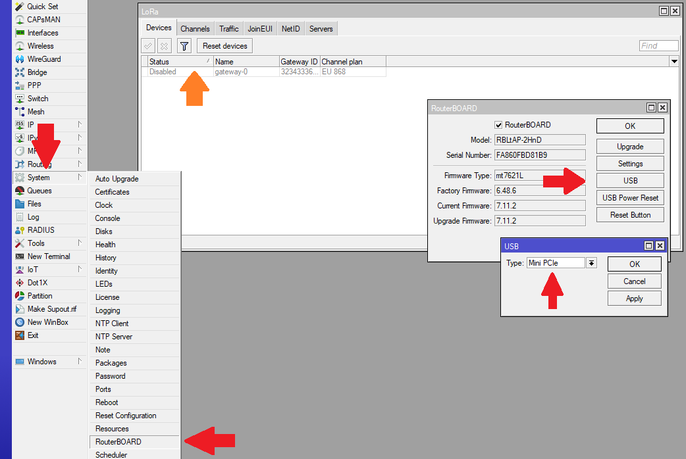

Once the gateway has shown up (under **IoT>LoRa>Devices**), select it, choose Network Servers from the default ones or add your own (under **IoT>LoRa>Servers**) and enable it:
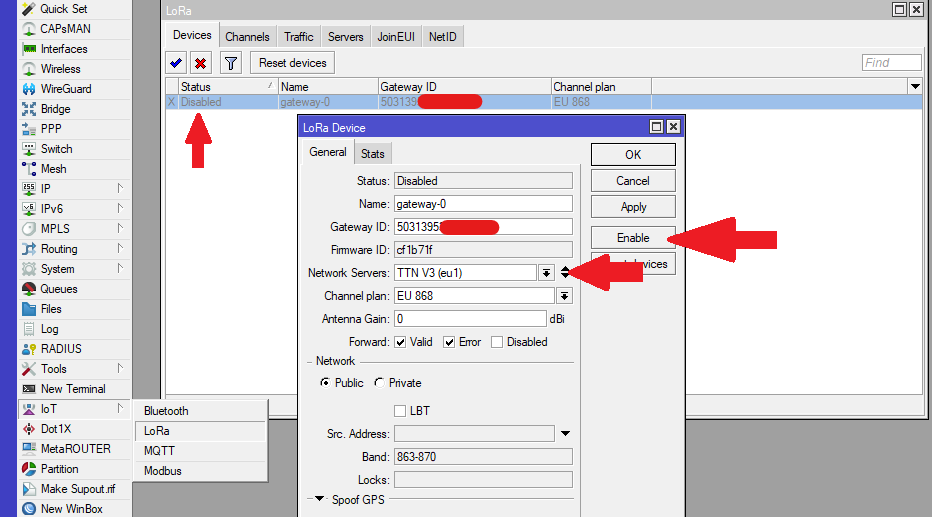

Navigate to the Traffic tab to monitor the surrounding nodes sending requests:
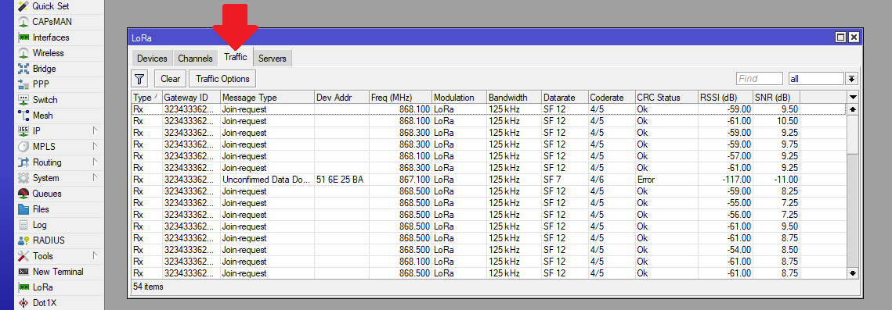

This concludes basic installation and configuration of LoRa mini-PCIe cards. For additional settings check: [General Properties](/docs/7.24/internet-of-things/lora/general-properties)
