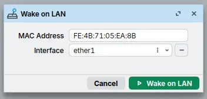

[*Wake on LAN CLI Reference*](/docs/7.24/cli-reference/tool/wol)

**Sub-menu:** `/tool/wol`

Wake on LAN (WoL) is a network feature that sends a UDP Magic Packet to the broadcast address. This packet contains the MAC address of the target device. If the target device supports Wake on LAN (meaning it has the required hardware and software configuration), it powers on from a sleep or shutdown state. Secure WoL is not supported.

## Wake-on-LAN Command

The `/tool/wol` command requires a MAC address parameter and an interface to function properly.

:::warning
If no interface is specified, the Magic Packet is sent as an IP broadcast from the default gateway interface.
:::

```ros
/tool/wol mac=FE:4B:71:05:EA:8B interface=ether1
```

The following example shows the Wake on LAN tool in [WinBox](/docs/7.24/management-tools/winbox).


