### Summary

This example shows how to configure an automatic fail-over (bonding) 5Ghz link in combination with 60Ghz devices in the GUI.  
When a connection between 60Ghz wireless is lost, it will automatically use the bonded interface.  
The example is done from empty configuration state with [[WinBox](https://mikrotik.com/download)] utility

### Connect to the device

After configuration reset - only mac-telnet is possible. In the main WinBox screen press on Neighbours, choose your device's MAC address and press Connect:

1. Select the correct device **MAC Address.**
2. The default login is "**admin**" and no password is set.
3. Press **Connect.**

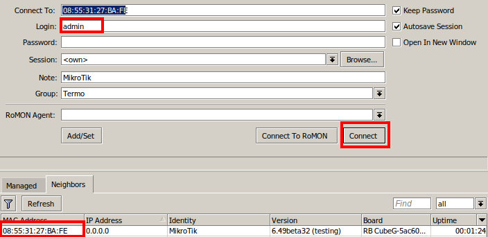

### Configure bridge

Add new bridge:

1. Open the Bridge sub-menu;
2. Press on "+" to add a new bridge;
3. Apply your changes.

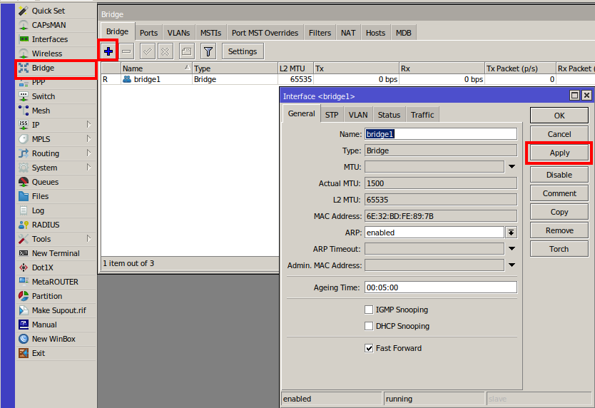

*Later in the instructions it requires assigning bridge members to it. This will allow passing traffic from Ethernet to W60G interface without routing.*

### Set up 60Ghz wireless connection

All previously explained steps are identical to **bridge** and **station** devices. Different modes need to be used when configuring wireless interfaces.

Configure **bridge** device as follows:

1. Open the Interface menu;
2. Double click on the wlan60-1 interface;
3. Click the Wireless sub-menu and set mode to **bridge** (or **ap-bridge** for PtmP);
4. Set the SSID and password and region;
5. Select the previously created bridge under "Put Stations In Bridge";
6. Apply your changes;
7. Press Enable to start transmitting.

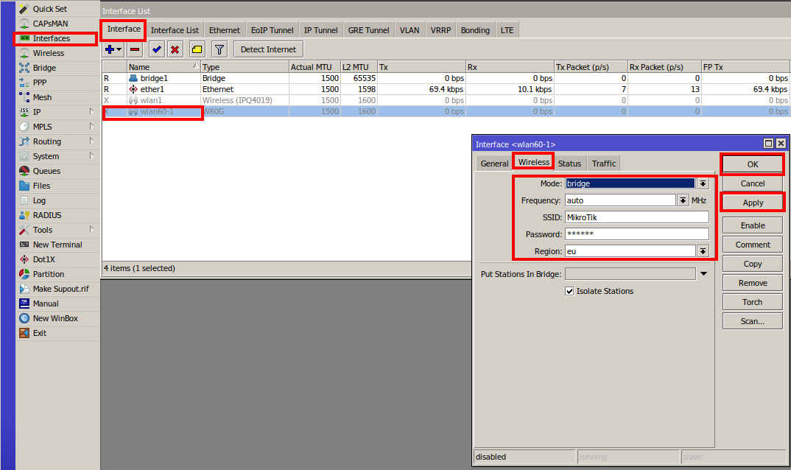

Configure **station** device as follows:

1. Open Interface menu;
2. Double click on wlan60-1 interface;
3. Press on Wireless sub-menu and set mode to **station bridge**;
4. Set SSID and password;
5. Apply your changes;
6. Press enable to start transmitting.

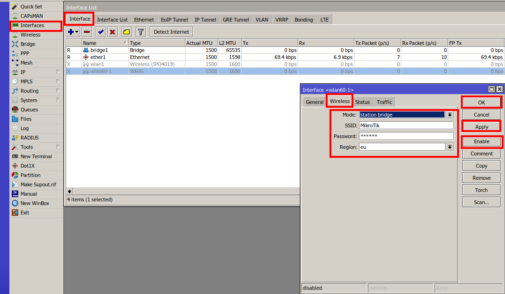

### Set up 5Ghz wireless connection

#### Choose Security Profile for your devices

1. Choose the **Wireless** menu;
2. Choose the **Security Profiles** sub-menu;
3. Add a new profile with the "**+**" sign;
4. Choose **a name**, **mode**, **authentication type** and a secure password;
5. **Apply** the configuration.

**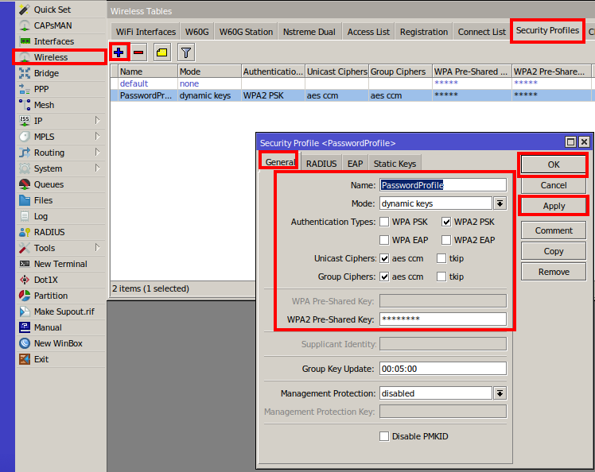**

#### For bridge device

1. Open the **Interfaces** menu;
2. Double click on the **wlan1** interface;
3. Press on the **Wireless** sub-menu and set mode to **bridge** (or **ap-bridge** for PtmP);
4. Set **SSID**, **password** and **country**;
5. Press on the **Advanced Mode**;

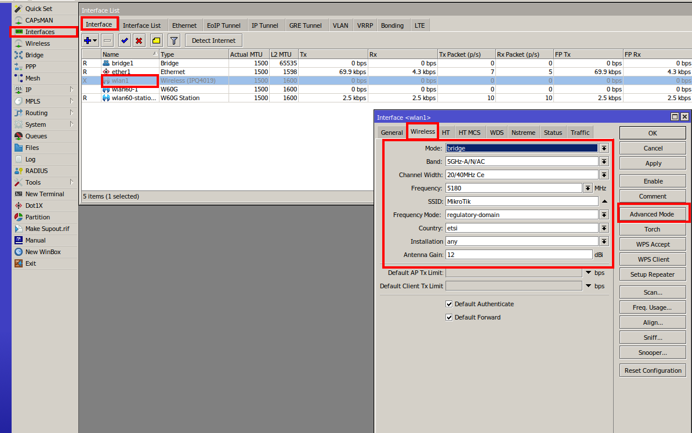

1. Choose your **Security Profile**;
2. **Apply** your changes;
3. Press **enable** to start transmitting.

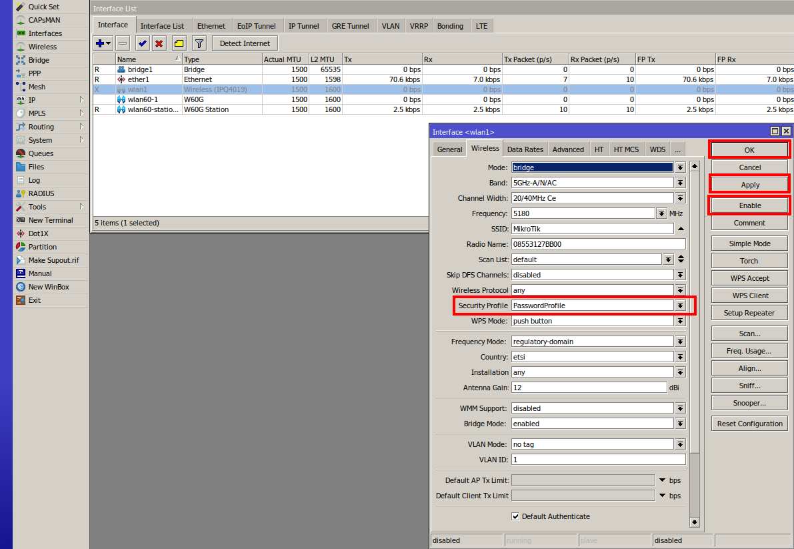

#### For station device

1. Open the **Interfaces** menu;
2. Double click on the **wlan1** interface;
3. Open the **Wireless** sub-menu and set mode to **station-bridge**;
4. Set **SSID**, **password** and **country**;
5. Open the **advanced** mode (similar to the bridge device\*);
6. Choose **Security Profile**;
7. **Apply** your changes;
8. Press **enable** to start transmitting.

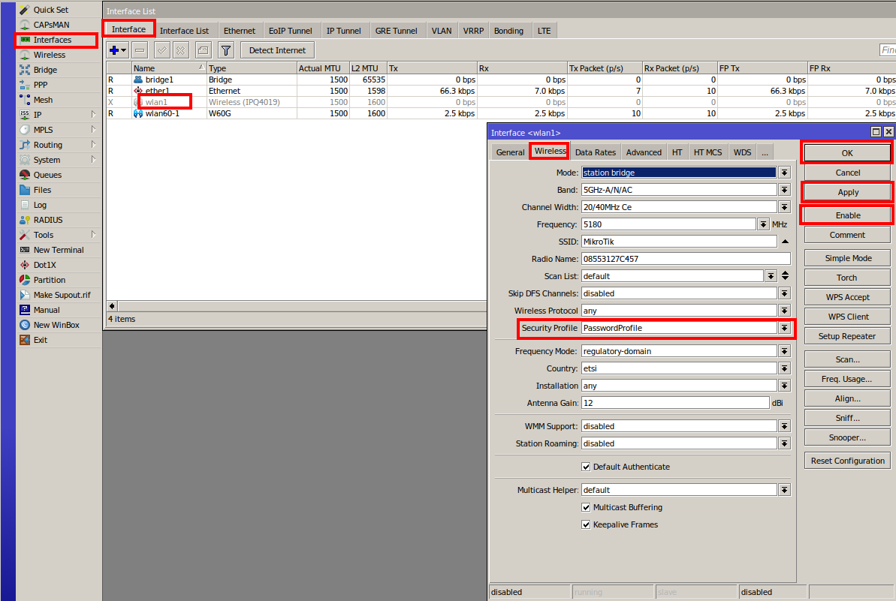

*If everything is done correctly - running (R) flags should appear as shown in the screenshot:*  
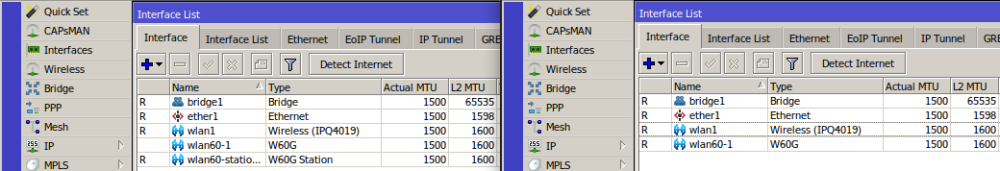

### Configure bonding

*Configure bonding and assign slave interfaces in this setup it is selected as the built-in wlan1 interface, but it can also be an ether interface in other kinds of setups.*

#### For bridge device

1. Press the **Bonding** sub-menu;
2. Add a new member with "**+**";
3. Add interface members (**wlan1** and **wlan60-station-1**) to the **bonding** interface as **Slaves**;
4. Add interface member **wlan60-station-1** as the **Primary** interface;
5. Choose Mode as **active backup**;
6. **Apply** the configuration.

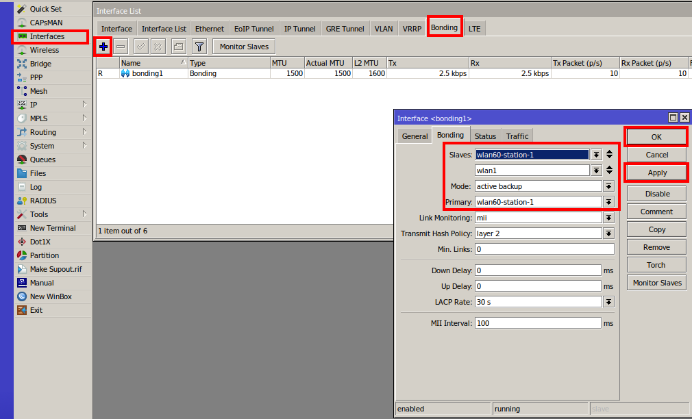

#### For station device

1. Press on the **Bonding** sub-menu;
2. Add a new member with "**+**";
3. Add interface members (**wlan1** and **wlan60-1**) to the **bonding** interface as **Slaves**;
4. Add the interface member **wlan60-1** as the **Primary** interface;
5. Choose Mode as **active backup**;
6. **Apply** the configuration.

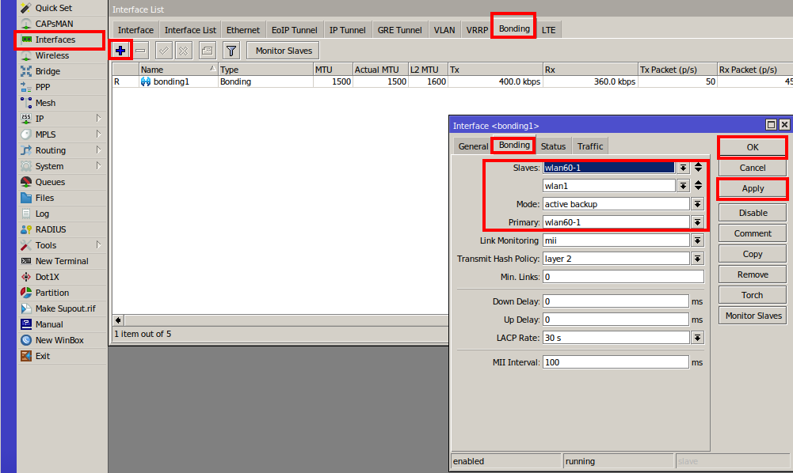

### Configure bridge

*Configuring bridge settings including the bonding interface is mandatory for the active-backup to work on used devices (In this case bridge and station device settings are the same):*

1. Press on the **Bridge** sub-menu;
2. Add a new member with "**+**";
3. Add the interface member as **ether1** and the Bridge member as **bridge1**;
4. **Apply** the configuration;

*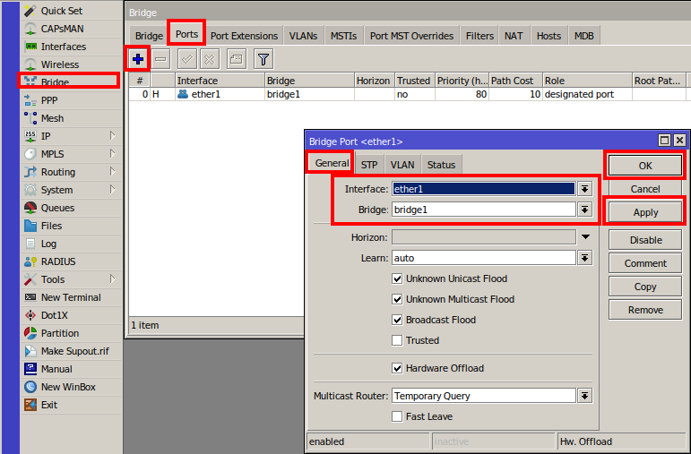*

1. Press on the **Bridge** sub-menu;
2. Add a new member with "**+**";
3. Add the interface member as **bonding1** and the Bridge member as **bridge1**;
4. **Apply** the configuration.

*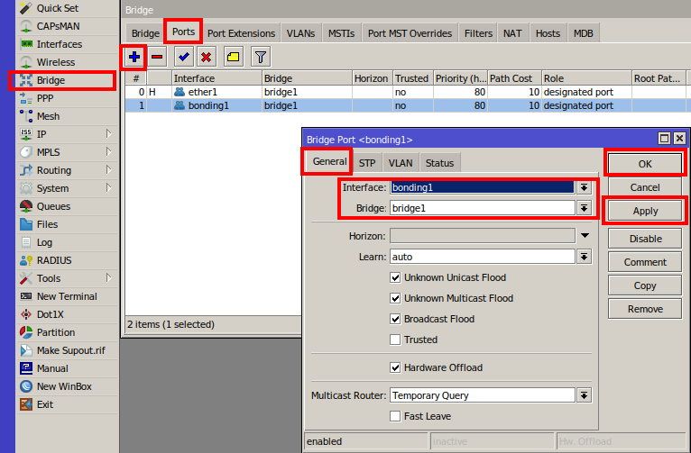*

### Additional configuration

Interfaces, when enabled from greyed out, will become active.

Link should be established after all previously explained steps are done. It's recommended to set up an administrator password on both devices.
