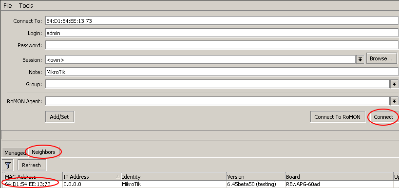
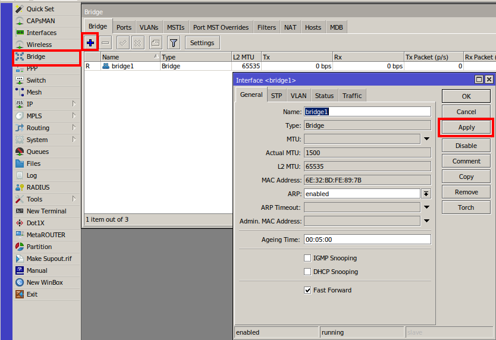
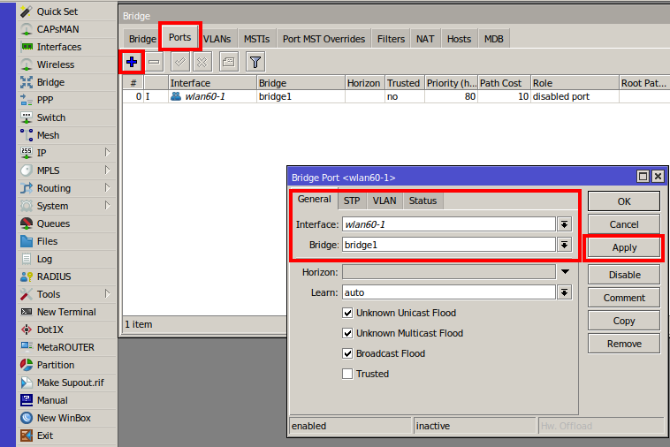
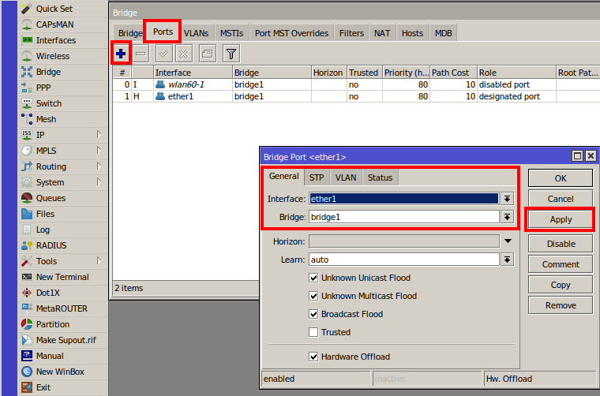
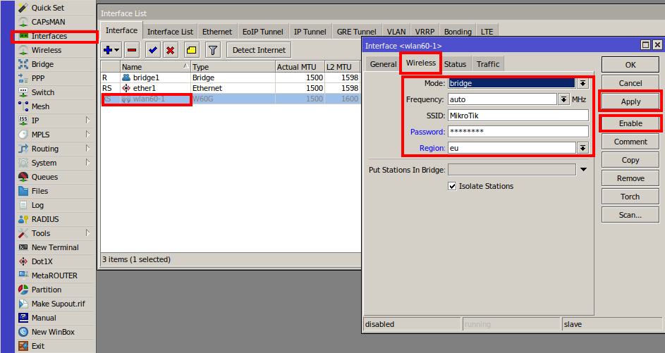
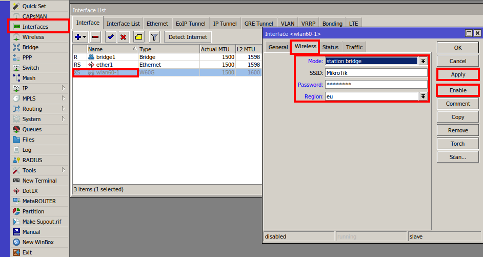

### Summary

This example shows how to configure a transparent wireless bridge in the GUI from one W60G device to another.

Example is done from an empty configuration state with the [[WinBox](https://mikrotik.com/download)] utility

### Connect to the device

After configuration reset - only mac-telnet is possible. In the main WinBox screen press on Neighbours, choose your device's MAC address and press Connect:

### Configure bridge

Add a new bridge and assign bridge members to it. This will allow passing traffic from Ethernet to W60G interface without routing:

1. Open the Bridge sub-menu;
2. Press on "+" to add a new bridge;
3. Apply your changes.

Add interface members (ether1 and wlan60-1) to newly created bridge:

1. Press on the Ports sub-menu;
2. Add a new member with "+";
3. Select the correct interfaces;
4. Apply the settings.

### Set up wireless connection

All previously explained steps are identical to **bridge** and **station** devices. Different modes need to be used when configuring wireless interfaces.

Configure **bridge** device as follows:

1. Open the Interface menu;
2. Double click on the wlan60-1 interface;
3. Press Wireless sub-menu and set mode to **bridge**;
4. Set SSID and password and region;
5. Select the previously created bridge under "Put Stations In Bridge";
6. Apply your changes;
7. Press enable to start transmitting.

Configure **station** device as follows:

1. Open the Interface menu;
2. Double click on wlan60-1 interface;
3. Press the Wireless sub-menu and set mode to **station bridge**;
4. Set SSID and password;
5. Apply your changes;
6. Press enable to start transmitting.

### Additional configuration

Interfaces, when enabled from greyed out, will become active.

The link should be established after all previously explained steps are done. It's recommended to set up an administrator password on both devices.

To create a point to multi-point setup: On the bridge device ap-bridge must be set and station-bridge for stations.
